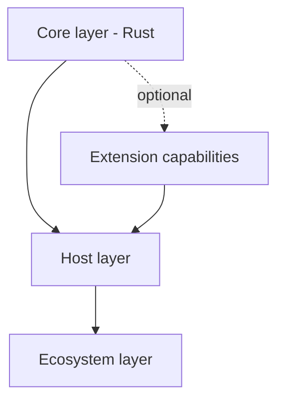

# ModuKit

> **ModuKit Runtime** — a modular plugin framework and polyglot extension toolkit.  
> Rust core · C ABI · in-process & multi-process plugins · service registry · script hosts · optional UI composition / zero-copy SHM / remote WebRTC

ModuKit is a **modular plugin host framework** for large-scale projects — large HMI, smart cockpit, multi-process UI hosts, remote streaming composition.

- **Core**: plugin lifecycle management (in-process and multi-process), service registry, polyglot bindings, script extension.
- **Optional extensions**: multi-process UI composition, zero-copy shared-memory transport, multi-machine remote WebRTC streaming.

It does not try to be a single "do-it-all engine". A layered architecture decouples the core plugin framework from the optional UI/streaming extensions: embed it as a lightweight plugin system, or build a complete distributed HMI host.

Full rationale, architecture, risks and references: **[whitepaper](docs/whitepaper.md)** (v1.0).
Adjudicated architecture baseline (2026-10-15, records specific post-v1.0 deltas — delta table: its §9): **[architecture](docs/architecture.md)** · [module docs](docs/modules/00-overview.md) · decision ledger (full index: architecture.md §11).

## Key capabilities

| Capability | Notes |
|---|---|
| Plugin lifecycle | install / start / stop / update / uninstall; unified model for in-process (`cdylib` + C ABI) and multi-process plugins (supervisor-managed, crash isolation, auto-restart) |
| Service registry | type-safe service discovery and dependency injection |
| IPC abstraction | one interface over local sockets, shared memory, remote transport |
| Capability discovery | platform differences (SHM, windowing, input injection, GPU sharing) declared and checked explicitly |
| Polyglot bindings | C/C++/Rust native · Python (PyO3) · C# (csbindgen) · JS/Node (napi-rs), all generated from the C ABI |
| Script & sandbox | Lua (mlua) · embedded JS (QuickJS/Boa) · WASM sandbox (wasmtime) for untrusted plugins |
| UI composition | main HMI as compositor; child processes submit frames via Wayland/X11 or SHM (I420), input events routed back |
| Remote streaming | WebRTC (webrtc-rs); the whitepaper-era name `getstream-rtc` is an audited mis-citation — the crate is `getstream`, a vendor cloud-SFU SDK candidate, not an open-source transport lib (`docs/reference/webrtc-rust-state.md`); receiver decodes to I420 and hands frames to the host over SHM |

## Architecture layers



- **Core**: plugin lifecycle, service registry, IPC abstraction, config & capability discovery
- **Host**: stable C ABI, binding generation, script engine hosts, transport abstraction
- **Ecosystem**: native / managed / sandboxed / script plugins
- **Extensions**: multi-process UI compositor, zero-copy SHM transport, remote WebRTC streaming

## Crate map

Shipped — workspace under `crates/` (v1 surface frozen STABLE, `docs/architecture.md` §11 / D87):

```text
crates/modukit-core        # kernel: lifecycle, registry, manifest, bundle, bus, clock, logger,
                           #   executors (dl + exe) with supervisor, TL-versioned proc wire
crates/modukit-runtime     # host binaries: modukit-run (shadow runner) · modukit-host (supervisor loop)
crates/modukit-transport   # transport seam: socketpair/memfd, SCM_RIGHTS fd-passing, optional vendor-shm (iceoryx2)
crates/modukit-codegen     # protoc plugin (protoc-gen-modukit): Rust skeletons, C ABI shades, fdset decoder
```

Planned (whitepaper §2.3 namespace; naming authority `docs/whitepaper.md` §2/§4):

```toml
modukit-compositor    # multi-process UI compositor (extension)

modukit-c             # C ABI export
modukit-py            # Python bindings
modukit-cs            # C# bindings
modukit-js            # JS/Node bindings
modukit-wasm          # WASM host & sandbox
modukit-script-lua    # Lua extension host
modukit-script-js     # QuickJS/Boa extension host

modukit-platform-linux / win / macos
modukit-cli           # command-line tooling
```

## Roadmap

Five stages per the whitepaper implementation path:

- [x] **Stage 1** — in-process plugin kernel: OSGi-style lifecycle & service registry — closed 2026-10-16 ([plan of record](docs/stage-1-plan.md))
- [x] **Stage 2** — multi-process plugins & zero-copy IPC: iceoryx2/Zenoh, I420 SHM transport — closed 2026-10-18 ([plan of record](docs/stage-2-plan.md))
- [x] **Stage 3** — re-scoped to stability & docs hardening (UI composition demoted to research tier per D89-K2) — accepted and closed 2026-10-19 ([plan of record](docs/stage-3-plan.md))
- [x] **Stage 4** — INFRA volume: bindings / communication / debugging — C/C++ line shipped M1+M2+M3 (embed face, sup rung, service-call door); accepted and closed 2026-10-21 ([plan of record](docs/stage-4-plan.md))
- [ ] **Stage 5** — remote WebRTC: encode, stream, route input back (renumbered by the §12 amendment; the polyglot & script ecosystem line dissolved into stage-4 wave-2 candidates)

## Platform support

| Platform | Local IPC | UI composition | Input injection | Notes |
|---|---|---|---|---|
| **Linux** | iceoryx2 / memfd | Wayland / X11 | uinput / XTest | primary validation platform (Ubuntu 20.04 first) |
| **Windows** | iceoryx2 / shared memory | Win32 (`SetParent`) | SendInput | needs PAL adaptation |
| **macOS** | iceoryx2 / shm_open | Cocoa (restricted) | CGEventPost | cross-process UI tightly limited; prefer pixel-stream |

## Development status

As-built: four shipped crates — `crates/modukit-core`, `crates/modukit-runtime`, `crates/modukit-transport`, `crates/modukit-codegen` (v1 API surface frozen STABLE per `docs/architecture.md` §11, D87; test totals are volatile and live in the plans of record) — plus the Stage-4 bindings line: `contracts/modukit_embed.h` (HostEmbedV1, 24 verbs over two rungs incl. the sup service-call door), `contracts/modukit_plugin.h`, the generated C++ faces and the `bindings/cpp` shelf (M1/M2/M3 closed; the volume was accepted and closed 2026-10-21, D95). Stages 1-4 are closed (D88, D91, D95). Crate naming and layout authority: `docs/whitepaper.md` §2 and §4.

First-time machine setup for dev toolchains (user-level, via mise; idempotent): `./bootstrap.sh` (Linux/macOS) or `bootstrap.bat` (Windows native). Pins live in `mise.toml`.

## Runnable examples

The stage demos are the gallery - runnable ground truth, no docs-only promises:

| Demo | Proves | Run |
|---|---|---|
| [stage1_demo](examples/rs/stage1_demo.rs) | in-process (`dl`) chain end to end: cdylib -> bundle -> D28 install -> lifecycle walk -> service echo -> bus late-join -> uninstall; negatives: tampered refused at the install door, ABI-lie parks FAILED | `bash scripts/demo-stage1.sh` (needs `pixi` on PATH) |
| [stage2_demo](examples/rs/stage2_demo.rs) | process placement on the frozen v1 surface: `exe` bundle -> HELLO cross-check -> proxy echo kernel-side -> wire dial -> crash/revive budget -> ORPHAN-PROOF (SIGKILL the host, the runner self-dies, zero strays) | `bash scripts/demo-stage2.sh` |
| [cpp-host-demo](examples/cpp/host_demo.cc) | Stage-4 M1 embed face from C++: one host embedding the kernel via the generated `HostEmbedV1` wrapper + the real built `cpp-example-plugin` .so -> install/resolve/start/service_call/bus/clock/introspect (both opaque codecs parsed)/stop/uninstall, the full 16-verb v1 word list | `bash scripts/demo-stage4-m1.sh` (needs `pixi` + the pinned-env protoc; SKIPs cleanly when the cpp band auto-skips) |
| [cpp-host-sup-demo](examples/cpp/host_sup_demo.cc) | Stage-4 M2 exe rung from C++: `sup_*` verbs install -> dial -> READY walk, then host SIGKILL -> runner self-reap census = ORPHAN-PROOF under a C++-authored host | `bash scripts/demo-stage4-m2.sh` (same auto-skip rules; sabotage hook documented) |

All six demo legs - the four above plus the Stage-5 N2 cross-wall demo (`scripts/demo-stage5-n2.sh`) and the wave-2 debug-reader face (`scripts/demo-wave2-reader.sh`) - are wired as standing legs of the local gate (`bash scripts/check.sh` runs them), and each is falsifiable by design (stage2, stage4-m1/m2, stage5-n2 and wave2-reader carry documented sabotage hooks). The plugins/ shelf stays grammar-reserved: the first production plugin opens it with its landing.


## Project language policy

All project artifacts (code, comments, docs, memory files) are written in English; AI-session chat follows the user's language. See `.agents/memorys/conventions.md` C1.

## License

Dual-licensed **MIT OR Apache-2.0** (SPDX: `MIT OR Apache-2.0`).
See [LICENSE-MIT](LICENSE-MIT) and [LICENSE-APACHE](LICENSE-APACHE).
Decision record: `.agents/memorys/decisions.md` D1. Contributions require DCO (`git commit -s`).
