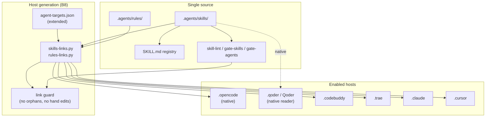

# Agent Host & Skill Surface Plan

> STATUS: PROPOSED, 2026-10-30 (revision 3, user-adjudicated one by one). No code
> changes yet; this plan elaborates VE-parity B8 and the project-level skill
> repairs identified in the 2026-10-30 review. B8 stays deferred in the plan of
> record until this proposal is accepted. Functional code, contracts, ABI, and
> packaging are OUT.

## 0. Why now

The repository already has a project-level skill surface in `.agents/skills/`
(40 directories; `skill-lint` 40/0). The open gap is not inventory; it is
portability and freshness:

- `scripts/agent-targets.json` enables only `opencode` and a project MCP target;
  no `.codebuddy` / `.trae` / `.claude` / `.cursor` skill/rules layer exists.
  Qoder is the current native reader; it is not a generated host target.
- `skills-links.py` and `rules-links.py` are already expected optional layers in
  `agents-cli.py` / `agent-links.py`; the implementation must fit those contracts.
- `shipping-and-launch` still names 16 gates and `pixi run pack-check`; the repo
  runs 34 gates and packaging is out of scope (Adjudication #20 C).
- `test-harness` still scans `openspec/specs/` and
  `docs/plans/p0-milestone-roadmap.md`; both are absent/inoperative here.
- `create-skill` exists only as an IDE-level helper; ModuKit has no
  project-level authoring contract for its own registry and gates.

Cross-agent IDE use is now a real requirement, so the B8 trigger has fired. B8
remains deferred in the plan of record until this proposal is accepted and the
host list is approved.

## 1. Goal and boundary

**Goal**: make `.agents/skills/` a portable project-level capability: the same
active skills and rules are visible to every enabled host, the registry stays
single-source, stale skills are repaired or explicitly retired, and adding a
skill follows one documented path.

**In scope**

- B8 host link layer: `skills-links.py`, `rules-links.py`, an extended
  `agent-targets.json` (no second target file), host link directories, Windows
  `--copy`, link guard.
- Project skill repairs: `shipping-and-launch`, `test-harness`.
- New project-level `skill-authoring` skill.
- Host discovery validation and docs.
- `gate-agents` / `gate-skills` / `skill-lint` integration.

**Out of scope**

- Functional code, contract, ABI, wire, binding, or demo changes.
- Packaging/install (`cmake --install`, pkg-config, pack-check, npm-pack).
- `gate-prose`, prose policy, SDD depth, UI/web/Qt/wasm.
- MCP pin changes, new MCP servers, ABI verbs.
- Copying Qoder-only `qoder-ide-helper`, `canvas`, or `vercel-deploy`.

## 2. Current state

| Surface | Current |
|---|---|
| Skill source | `.agents/skills/` (40 dirs) |
| Registry | `SKILL.md` (40 rows) |
| Lint/gates | `skill-lint` 40/0; `gate-skills`; `gate-agents` |
| Host targets | `opencode` (native skills/rules, MCP merge), `project` (MCP only) |
| Native reader | Qoder session (project skills visible; path to verify in H0) |
| Host layers | no `.codebuddy` / `.trae` / `.claude` / `.cursor` |
| Inactive | 5 `openspec-*` + `browser-testing` |
| Aliases | `ecosystem-scan`, `review-hardcode` |
| Stale | `shipping-and-launch`, `test-harness` |

## 3. Diagram



The dashed gap is current state: source and gates exist, but the generation
box is absent, so only native readers (`opencode`, Qoder) see the skills;
CodeBuddy/Trae/Claude/Cursor do not.

## 4. Work breakdown

### H0 - Baseline and host matrix (0.5 day)

- Record the enabled host list and each host's discovery path.
- Include Qoder in the validation matrix as a native reader; add a `.qoder`
  target only if its discovery path proves it needs one.
- Decide symlink-by-default vs copy-by-default (Windows fallback: copy).
- Confirm generated host layers are ignored, not hand-edited.
- Deliverable: extend `scripts/agent-targets.json` with `enabled`, `format`,
  `skills_dir`, `rules_dir`, and `notes` per host. Do NOT create a second
  `skills-targets.json`; two target lists would drift.

Acceptance: a host matrix exists; no code changes beyond the config skeleton.

### H1 - B8 host link layer (1-2 days)

- H1.1 `scripts/skills-links.py`: CLI `sync|check|status` (the existing
  `agents-cli.py` already calls it; `--copy` is forwarded). It reads the
  extended `agent-targets.json`; no separate target file.
- H1.2 `scripts/rules-links.py`: module loaded by `agent-links.py`, exposing
  `run(command, targets, cfg, dry_run)`; it must not implement a standalone
  target list or a second dispatcher.
- H1.3 Host directories: `.codebuddy/`, `.trae/`, `.claude/`, `.cursor/`.
- H1.4 `agents sync` invokes the link sync; pre-commit/gate checks drift.
- H1.5 Link guard: reject a host layer that is not generated, a broken link,
  or a forbidden directory (e.g. a hand-written skill copy).

Acceptance:

```bash
bash scripts/check.sh --list          # existing gate count unchanged
pixi run agents sync                  # generates enabled host layers
pixi run gate-agents                  # generated layers clean
pixi run gate-skills                  # registry still 40+
git ls-files -ci --exclude-standard   # must stay empty
```

### H2 - Repair and extend the project skill surface (1 day)

- H2.1 `shipping-and-launch`: replace "16 gates" with "34 gates"; remove
  `pack-check`/tarball steps; state packaging is out of scope; keep release,
  tag, rollback, and `pixi run ci` as the gate.
- H2.2 `test-harness`: replace `openspec/specs/` with `docs/sdd/` and
  `spec-trace`; remove `docs/plans/p0-milestone-roadmap.md`; or mark the skill
  inoperative if the rewrite is not worth it.
- H2.3 Add `.agents/skills/skill-authoring/SKILL.md` (project-level):
  frontmatter, optional `.skill_id`, `SKILL.md` registry row, `agents sync`,
  `skill-lint`, C1 English, host target compatibility, `inoperative` and
  `deprecated alias` states.
- H2.4 `skill-router`: add `skill-authoring` to the Audit/authoring route only
  when it reduces ambiguity; do not add a second routing table.

Acceptance:

```bash
rg -n "pack-check|16 gates|openspec/specs|p0-milestone" .agents/skills
# no hits in active skills
python3 scripts/skill-lint.py        # 41/0 after skill-authoring
pixi run gate-skills
pixi run gate-agents
```

### H3 - Host validation (0.5-1 day)

- For each enabled host, including Qoder, open the host and verify one
  representative skill (`repo-audit`), one workflow skill (`think-before-act`),
  and one rule file.
- Negative proof: remove one generated link -> `gate-agents` red; restore -> green.
- Windows: exercise `--copy` once; if no Windows box, record SKIP explicitly
  (same convention as existing Windows debt).
- Document discovery paths and the generated-vs-source rule in `docs/env.md`.

### H4 - Closeout (0.5 day)

- Update `docs/ve-parity-plan.md` B8 status and `docs/env.md` host matrix.
- Keep this plan internal: add `docs/agent-host-parity-plan.md` to
  `book-build.INTERNAL_PREFIXES` (or a `visibility = "internal"` toc entry).
- Record the C5 memory disposition at batch close.
- Run `pixi run ci`, `agents check`, `skill-lint`, and `gate-docs`.
- Add a short "how to add a host" section to `skill-authoring` or `docs/env.md`.

## 5. Milestone outline

| Milestone | Content | Exit |
|---|---|---|
| M0 | Host matrix + targets skeleton | extended `agent-targets.json` reviewed |
| M1 | Skills/rules links + guard | `agents sync` / `gate-agents` green |
| M2 | Stale skills repaired + `skill-authoring` | `skill-lint` 41/0; no stale refs |
| M3 | Host discovery proof | each enabled host sees 3 samples |
| M4 | Docs and closeout | `pixi run ci` green; C5 recorded |

## 6. Risks and rollback

| Risk | Mitigation |
|---|---|
| Wrong host path silently unread | Verify each host with a real open, not a directory guess |
| Symlink portability on Windows | `--copy` fallback; record SKIP if no Windows box |
| Generated links become tracked | `.gitignore` host dirs; `git ls-files -ci` must be empty |
| Skill duplication/drift | Single source `.agents/skills`; links only |
| Stale skill repairs drift again | `skill-authoring` + `skill-lint` + review |
| Host-specific format not supported | Disable that target; do not invent a copy |

Rollback: remove the target from `agent-targets.json`, delete generated host
dirs, run `agents sync`; source skills and gates remain untouched.

## 7. Definition of Done

- Enabled host layers generated by scripts, not hand-written.
- `agents sync` / `gate-agents` / `gate-skills` green.
- `skill-lint` includes `skill-authoring`, 0 fail.
- `shipping-and-launch` and `test-harness` no longer reference nonexistent
  tasks/artifacts, or are explicitly inoperative.
- `git ls-files -ci --exclude-standard` empty.
- `pixi run ci` green.
- `docs/env.md` documents the host matrix and the source-vs-generated rule.

## 8. Adjudicated decisions (2026-10-30, user-adjudicated one by one)

| # | Decision | Ruling | Note |
|---|---|---|---|
| 1 | Host scope | **C: one pilot host + Qoder native** | Pilot host name is chosen in H0 from actual use; other hosts are added later by config |
| 2 | Link strategy | **A: symlink default, copy fallback** | POSIX symlink; Windows/unsupported hosts use `--copy` with a hash/stamp |
| 3 | `test-harness` | **C: partial repair** | Keep generate/run/coverage; replace spec discovery with `docs/sdd`/stage plans; mark openspec-only modes inoperative |
| 4 | Authoring scope | **A: `skill-authoring` only** | `subagent-authoring` deferred until a real subagent definition layer exists |

Open items after adjudication:

- Pilot host name (H0; pick the host the maintainer actually uses).
- Cursor is not in the first batch; add it through `agent-targets.json` only after
  the pilot proves the link generator.
- `shipping-and-launch` repair is H2.1 and needs no separate ruling (packaging is
  out of scope; release gate is 34 gates + no `pack-check`).
- The plan stays PROPOSED until the maintainer accepts the H0 host name.
