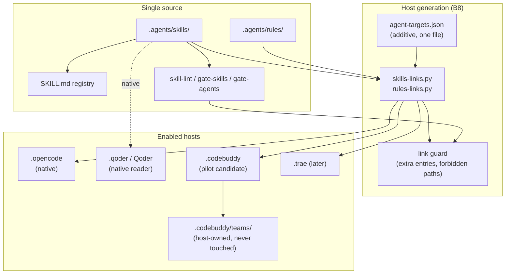

# Agent Host & Skill Surface Plan

> STATUS: IN EXECUTION, 2026-10-30 (revision 6). Maintainer word given
> 2026-10-30; H0a / H0b / H1 / H2a are landed, H3 needs a host restart, and
> H2b / H4 remain. This plan elaborates VE-parity B8 and the project-level
> skill repairs. Revision 4 recorded the execution findings; revision 5 folded
> the facts / host / plan review; revision 6 records the implementation.
> Rulings #1-#4 are unchanged. Functional code, contracts, ABI, and packaging
> are OUT.

## 0. Why now

The repository already has a project-level skill surface in `.agents/skills/`
(41 directories; `skill-lint` 41/0). The open gap is not inventory; it is
portability and freshness:

> Historical trigger snapshot (revision 4). Current state is section 2; the
> bullets below are the proposal-time observations, not today's tree.

- At proposal time, `scripts/agent-targets.json` enabled only `opencode` and a
  project MCP target; no generated `.codebuddy` / `.trae` / `.claude` / `.cursor`
  rules or skills layer existed. `.codebuddy/teams/` does exist as IDE session
  state (gitignored) and is never generated, checked, or pruned by this plan.
- Qoder is the current native reader; it is not a generated host target.
- `skills-links.py` and `rules-links.py` are already expected optional layers in
  `agents-cli.py` / `agent-links.py`; the implementation must fit those contracts.
- `shipping-and-launch` and `test-harness` are already repaired by the B5a
  import (`e5d5d28`) plus the 2026-10-30 audit (`d8e1212`): the release skill
  names the current gate count and no `pack-check`; the harness uses `docs/sdd`
  and no `openspec/specs`. H2.1/H2.2 are verification-only now.
- At proposal time, `skill-authoring` was absent; H2a landed it. The remaining
  skill work was the activation-budget decision (H2b).
- At proposal time, `gate-rules` and `spec-trace` existed and passed manually but
  neither was a `check.sh` leg; H0a made both legs (36 total). Rule-citation
  liveness and the SDD trace are now inside the local `ci`.
- CodeBuddy is the daily host in the 2026-10-30 session: its `AGENTS.md` fallback
  loads the project context, but at proposal time none of the 40 project skills
  appeared in the host skill list and no project MCP tool was observed. H1/H2a
  generated the rules/skills layer; the H3 restart probe is pending.
- `docs/env.md` now carries the host matrix added by H3; H2b records the final
  activation policy there.

## 1. Goal and boundary

**Goal**: make `.agents/skills/` and `.agents/rules/` portable project-level
capabilities: the same active skills and rules are visible to every enabled host,
the registry stays single-source, stale skills are repaired or explicitly retired,
and adding a skill or a host follows one documented path.

**In scope**

- B8 host link layer for the pilot (CodeBuddy candidate): `skills-links.py`,
  `rules-links.py`, an additive extension to `agent-targets.json` (no second
  target file), host link directories, Windows `--copy`, and a link guard.
- CodeBuddy rules dialect: `.codebuddy/rules/<name>/RULE.mdc` with frontmatter
  and a language filter. Flat `.md` symlinks are dead files on CodeBuddy
  (VE D35), so the rules layer must be generated, not linked.
- CodeBuddy skills: `.codebuddy/skills/<name>` relative symlinks by default;
  Windows uses `--copy` plus a per-target hashed map.
- MCP: reuse the root `.mcp.json` (the project-level file); do not generate
  `.codebuddy/mcp.json` (upstream reports it is never loaded; VE D35).
- Project skill repairs: `skill-authoring` only. H2.1/H2.2 are verification.
- Host discovery validation, a host matrix in `docs/env.md`, and provenance rows
  for the two VE-derived scripts.
- P0 gate wiring: `gate-rules` joins `check.sh`; `spec-trace` becomes a leg or
  is explicitly documented as CI-only.
- `gate-agents` / `gate-skills` / `skill-lint` integration.

**Out of scope**

- Functional code, contract, ABI, wire, binding, or demo changes.
- Packaging/install (`cmake --install`, pkg-config, pack-check, npm-pack).
- `gate-prose`, prose policy, SDD depth, UI/web/Qt/wasm.
- MCP pin changes, new MCP servers, ABI verbs.
- Copying Qoder-only `qoder-ide-helper`, `canvas`, or `vercel-deploy`.
- `CODEBUDDY.md`: it suppresses the `AGENTS.md` fallback for every other host
  and forks the single memory source (VE D37). Do not add it.

## 2. Current state

| Surface | Current |
|---|---|
| Skill source | `.agents/skills/` (41 dirs) |
| Registry | `SKILL.md` (41 rows) |
| Lint/gates | `skill-lint` 41/0; `gate-skills`; `gate-agents` |
| Host targets | `opencode` (native), `project` (MCP only), `codebuddy` (optional; rules+skills) |
| Native reader | Qoder; CodeBuddy reads root `AGENTS.md` when `CODEBUDDY.md` is absent |
| Host layers | `.codebuddy/rules` (18 `RULE.mdc`), `.codebuddy/skills` (41 links); `.codebuddy/teams/` is host-owned |
| Inactive | 5 `openspec-*` + `browser-testing` |
| Aliases | `ecosystem-scan`, `review-hardcode` |
| Repaired | `shipping-and-launch` + `test-harness` (B5a import + `d8e1212` audit) |
| Missing | H3 host restart probe; H2b activation budget; H4 closeout |
| Gate wiring | `gate-rules` + `spec-trace` are `check.sh` legs (36 total) |
| Env doc | Host matrix + probe log added 2026-10-30; activation policy pending H2b |

## 3. Diagram



The dashed gap is current state: source and gates exist, but the generation
box is absent, so only native readers (`opencode`, Qoder) see the skills.
CodeBuddy sees `AGENTS.md` but not the 40 project skills. Host-owned
`.codebuddy/teams/` is explicitly outside the generated tree.

## 4. Work breakdown

### H0a - P0 gate wiring and count sweep (0.25 day)

No maintainer decision is needed here; this batch can land first.

- Add `gate-rules` as a `check.sh` leg; decide whether `spec-trace` is a leg or
  CI-only. If CI-only, the standby workflow already runs
  `scripts/spec-trace.sh`; add the matching note to `docs/env.md`.
- Regenerate `CONSTRAINTS.md` from `check.sh --list`; observe each new leg red
  before trusting it.
- Gate-count sweep: adding a leg changes the old "34 gates" prose in
  `.agents/skills/shipping-and-launch`, `.agents/skills/repo-audit`,
  `docs/env.md`, and any README/AGENTS line that names the count. Update the
  active surfaces in the same batch; historical changelog rows stay historical.
- Land on `master`; one C3 commit for this batch (one revert unit).

Acceptance:

```bash
set -euo pipefail
python3 -m json.tool scripts/agent-targets.json >/dev/null
bash scripts/check.sh --list | grep -qx gate-rules
bash scripts/check.sh --list | grep -qx spec-trace \
  || grep -q 'scripts/spec-trace.sh' .github/workflows/ci.yml
python3 scripts/rule-ref-lint.py
bash scripts/spec-trace.sh
git ls-files -ci --exclude-standard
```

### H0b - Host matrix and discovery probes (0.25 day)

- Record the enabled host list and each host's discovery path.
- Include Qoder in the validation matrix as a native reader; add a `.qoder`
  target only if its discovery path proves it needs one.
- Pick the pilot: CodeBuddy is the candidate (the session host on 2026-10-30);
  the maintainer word is recorded here.
- Decide symlink-by-default vs copy-by-default (Windows fallback: copy).
- Confirm generated host layers are ignored, not hand-edited.
- Deliverable: extend `scripts/agent-targets.json` **additively** with
  `label`, `enabled`, `optional`, `rules`, `skills`, `mcp`, `skills_dir`,
  `skills_delivery` (`link|copy|native`), `skills_allowlist` (optional),
  `rules_dir`, `rules_mode` (`mdc|links`), `langs`, `always_on_rules`,
  `rule_descriptions`, `mcp_file`,
  `mcp_shape`, `mcp_launcher`, and `notes`. Keep the existing per-surface
  booleans; a failed MCP probe must not disable the proven skills surface.
  Do NOT create a second `skills-targets.json`; two target lists would drift.
  Do not add a generic `format` key; delivery is per surface.
- Add top-level `forbidden_paths` (for example `CODEBUDDY.md`,
  `.codebuddy/mcp.json`, `.trae/skills`, `.cursor/skills`, `.claude/skills`) and
  `host_owned_dirs` (`[".codebuddy/teams"]`).
- Resolution rule: generate a host layer only when its per-surface flag is true
  and its directory key is present; a missing optional layer is a SKIP, not a
  finding. `opencode` and `project` must get explicit false/missing semantics so
  the new `skills-links.py` cannot index a missing `skills_dir`.
- Mark the `codebuddy` target `optional: true`: `.codebuddy/` is gitignored, and
  `gate-agents` runs `check` without a preceding `sync` on a fresh clone/CI.
  An absent `.codebuddy` rules/skills layer must be SKIP, not MISSING.

Host probe matrix:

| Surface | Probe | Pass |
|---|---|---|
| `AGENTS.md` | New CodeBuddy session shows project context | D109 line and conventions visible |
| Rules | Temporarily add `.agents/rules/common/probe.md`, sync, inspect `.codebuddy/rules/common-probe/RULE.mdc`, remove the canonical probe, sync again | Generated rule appears and is pruned cleanly |
| Skills | Existing skill `repo-audit` appears in `.codebuddy/skills` and the host list | Skill visible; no host-only directory |
| MCP | Root `.mcp.json` with one server | A real tool call succeeds after restart, not merely panel-visible |
| Forbidden | Add `CODEBUDDY.md` in a scratch tree | `gate-agents` red; remove -> green |
| Negative | Remove one generated rule or skill link | `gate-agents` red; restore -> green |

Acceptance:

```bash
set -euo pipefail
python3 -m json.tool scripts/agent-targets.json >/dev/null
grep -q '"optional": true' scripts/agent-targets.json
grep -q '"skills_delivery"' scripts/agent-targets.json
grep -q 'forbidden_paths' scripts/agent-targets.json
pixi run gate-agents
git ls-files -ci --exclude-standard
```

### H1 - B8 host link layer (1-2 days)

Land the target config (including `optional`) with the module, not after it;
`agent-links.py` starts gating as soon as `rules-links.py` exists.

- H1.1 `scripts/skills-links.py`: CLI `check|sync|dry-run|list` (the existing
  `agents-cli.py` calls check/sync; `--copy` is a flag, not a subcommand). It
  reads the extended `agent-targets.json`; no separate target file. A target
  directory may contain only relative symlinks back to the canonical tree; copy
  mode records hashes in a per-target map (`<host_root>/skills-link-map.json`,
  not one global `.codebuddy` path). The copied tree is hashed when comparing,
  not only the canonical tree. It must skip a target with `skills: false`, no
  `skills_dir`, or an absent optional layer (SKIP, not an error), and prune
  links whose canonical skill disappeared. If a target carries
  `skills_allowlist: [...]`, this script owns the allowlist: only listed skills
  are expected, and unlisted host entries are stale/pruned, not "missing".
  `agents-cli.py` must translate `agents sync --dry-run` /
  `agents check --dry-run` to the delegates' `dry-run` command (or expose an
  explicit `agents dry-run`); otherwise `--dry-run` silently writes.
- H1.2 `scripts/rules-links.py`: module loaded by `agent-links.py`, exposing
  `run(command, targets, cfg, dry_run)`; it must not implement a standalone
  target list or a second dispatcher. Add an `mdc` mode:
  - filter canonical rules by the target's `langs`. Start `common` + `rust`;
    this is a recorded deviation from VE's six-language set (section 8.2).
  - generate one folder per rule: `.codebuddy/rules/<lang>-<topic>/RULE.mdc`;
  - synthesize `description`, `alwaysApply`, `enabled`, `updatedAt`
    deterministically: `description` from `rule_descriptions` or the first H1,
    `updatedAt` from a content digest (never wall-clock, or the content-compare
    gate drifts every run); strip the canonical frontmatter; retarget
    same-folder and cross-folder rule links to the generated layout;
  - `always_on_rules` start at `common-constraints` and `common-security` only.
    `common-edit-safety` (30.62 KB) stays on-demand via `rule_descriptions`;
    the donor deliberately does not always-load it;
  - require one `rule_descriptions` entry per generated folder (18 today for
    common+rust; no fallback to a bare H1 trigger);
  - `docker.md` keeps its on-demand marker; emit it as `common-docker/RULE.mdc`
    with `alwaysApply: false`; no separate exclusion list;
  - before overwriting a differing generated `RULE.mdc`, keep a `.bak` beside it
    and report the overwrite; never delete a host-owned directory;
  - prune stale `.md` symlinks and old folders left by earlier attempts;
  - `gate-agents` compares regenerated content byte-for-byte for mdc targets
    (true-green, not link-existence).
- H1.3 Host directories: `.codebuddy/rules/` and `.codebuddy/skills/` for the
  pilot; `.trae/` / `.claude/` / `.cursor/` only when their discovery paths are
  proven. Never generate into `.codebuddy/teams/`.
- H1.4 `agents sync` invokes the link sync; pre-commit and `gate-agents` check
  drift. A `dry-run` must write nothing: `agents sync --dry-run` then
  `git status --short` is empty.
- H1.5 Link guard: scope generation and guard to `.codebuddy/rules` and
  `.codebuddy/skills`; allow `host_owned_dirs` (`.codebuddy/teams`) and the
  generated `.codebuddy/skills-link-map.json` untouched; report extra host
  entries and content drift (mdc overwrite is backed up, not silent). Reject
  `forbidden_paths` and a write that targets the canonical tree. Observe the
  forbidden-path red once.
- H1.6 MCP: the `codebuddy` target sets `mcp: false` and omits `mcp_file`; it
  consumes the root `.mcp.json` produced by the `project` target. Do not
  generate `.codebuddy/mcp.json`. A second target writing the same file is
  forbidden; `mcp_launcher` and `mcp_shape` stay on the `project` target.
  `mcp-links.py` must skip a target with `mcp: false` even if a future edit
  accidentally adds `mcp_file`.
- H1.7 Keep `.codebuddy/` gitignored; `generated_tracked` stays the five tracked
  files. Verify this is unchanged; a generated host file is never added to git.
- H1.8 Provenance: `rules-links.py` and `skills-links.py` are adapt copies from
  VE. Add both rows to `docs/reference/visiaengine.md` (source -> destination,
  adapt, B8/H1) and keep Appendix B in sync. A copied file without a row fails
  review.
- H1.9 Ordering: target config (including `optional`) lands with the module in
  one batch; otherwise the first `gate-agents` check on a clean clone reds.

Acceptance:

```bash
set -euo pipefail
pixi run agents sync
pixi run agents sync --dry-run
git status --short
pixi run gate-agents
pixi run gate-skills
python3 scripts/skill-lint.py         # current count, 0 fail (40 before H2a; 41 after)
grep -q 'rules-links.py' docs/reference/visiaengine.md
grep -q 'skills-links.py' docs/reference/visiaengine.md
git ls-files -ci --exclude-standard   # must stay empty
```

### H2a - Repair and extend the project skill surface (0.5-1 day)

H2a is parallel from day 1; H2b waits for H1 and the H3 measurement.

- H2.1 `shipping-and-launch`: CLOSED by the B5a import (`e5d5d28`) and the
  2026-10-30 audit (`d8e1212`). It names the current gate count and explicitly
  states packaging is out of scope; verify only. The H0a sweep owns the
  34 -> 35/36 count edit, not this task.
- H2.2 `test-harness`: CLOSED by the B5a import and the 2026-10-30 audit. It
  uses `docs/sdd` and the five clause prefixes; no `openspec/specs` or
  `p0-milestone` references remain; verify only.
- H2.3 Add `.agents/skills/skill-authoring/SKILL.md` (project-level):
  frontmatter, optional `.skill_id`, `SKILL.md` registry row, `agents sync`,
  `skill-lint`, C1 English, host target compatibility, `inoperative` and
  `deprecated alias` states.
- H2.4 `skill-router`: add `skill-authoring` to the Audit/authoring route only
  when it reduces ambiguity; do not add a second routing table.

Acceptance:

```bash
set -euo pipefail
count=$(bash scripts/check.sh --list | wc -l | tr -d ' ')
grep -q "$count gates" .agents/skills/shipping-and-launch/SKILL.md
grep -q "$count gates" .agents/skills/repo-audit/SKILL.md
! grep -q '16 gates\|pixi run pack-check' .agents/skills/shipping-and-launch/SKILL.md
grep -q 'docs/sdd' .agents/skills/test-harness/SKILL.md
! grep -q 'openspec/specs\|p0-milestone' .agents/skills/test-harness/SKILL.md
python3 scripts/skill-lint.py        # 41/0 after skill-authoring
pixi run gate-skills
pixi run gate-agents
```

### H2b - Activation budget (after H1 + H3 measurement)

- Decide full activation or a target-specific `skills_allowlist: [...]`. The
  owner is `skills-links.py` (H1.1); unlisted host entries become
  stale/pruned, not "missing".
- Record the decision and the measured host context cost in `docs/env.md`.
- The hub ceiling is real: `HUB_LIMIT = 30000`, `WARN = 28500`, `AGENTS.md`
  21,557 B today. H2.3 adds a registry row and H4 adds host prose; keep host
  prose in `docs/env.md`, not `AGENTS.md`.
- If a subset is used, express it in `agent-targets.json`; never add a second
  skills target file.

Acceptance:

```bash
set -euo pipefail
grep -q 'activation' docs/env.md
grep -q 'skills' scripts/agent-targets.json
pixi run gate-agents
```

### H3 - Host validation (0.5-1 day)

- For each enabled host, including Qoder, open the host and verify one
  representative skill (`repo-audit`), one workflow skill (`think-before-act`),
  one rule file, and one MCP server.
- Record the probe transcript (host skill list, one rule, one MCP row) in
  `docs/env.md` or the batch note. A future reader must be able to see that the
  host actually consumed the layer.
- CodeBuddy negative proof: remove one generated rule/link -> `gate-agents` red;
  restore -> green. Rule changes require a new session, because CodeBuddy loads
  rules at session start.
- Probe whether `provider` is required in the rule frontmatter; the generator
  emits four keys today. Record the result; add the key only if needed.
- Windows: exercise `--copy` once; if no Windows box, record SKIP explicitly
  (same convention as the existing Windows debt).
- Document discovery paths and the generated-vs-source rule in `docs/env.md`.

Acceptance:

```bash
set -euo pipefail
grep -q 'CodeBuddy' docs/env.md
grep -qi 'host matrix' docs/env.md
pixi run gate-agents
git status --short
```

### H4 - Closeout (0.5 day)

- Update `docs/ve-parity-plan.md` B8 status and the `docs/env.md` host matrix.
- Keep this plan internal: the `visibility = "internal"` toc entry and llms.txt
  line already exist.
- Record the C5 memory disposition at batch close.
- Run `pixi run ci`, `agents check`, `skill-lint`, `gate-docs`, `gate-rules`,
  and `spec-trace`.
- Add a short "how to add a host" section to `skill-authoring` or `docs/env.md`.

Acceptance:

```bash
set -euo pipefail
pixi run ci
pixi run agents check
python3 scripts/skill-lint.py
bash scripts/gate-docs.sh
python3 scripts/rule-ref-lint.py
bash scripts/spec-trace.sh
git ls-files -ci --exclude-standard
```

## 5. Milestone outline

| Milestone | Content | Owner | Verifier | Exit |
|---|---|---|---|---|
| M0a | P0 gate wiring + count sweep | docs/ci | orchestrator | `gate-rules` leg green; count prose consistent |
| M0b | Host matrix + targets skeleton + probes | agent-config | orchestrator | `agent-targets.json` reviewed; CodeBuddy session probes recorded |
| M1 | Skills/rules links + guard | rules/skills | orchestrator | `agents sync` / `gate-agents` green; dry-run writes nothing |
| M2a | `skill-authoring` + router | rules/skills | orchestrator | `skill-lint` 41/0 |
| M3 | Host discovery proof | agent-config | orchestrator | CodeBuddy sees skill + workflow skill + rule + MCP; transcript recorded |
| M2b | Activation budget (after M3 measurement) | agent-config | orchestrator | policy + measured cost in `docs/env.md` |
| M4 | Docs and closeout | ci/ide | orchestrator | `pixi run ci` green; C5 recorded |

## 6. Risks and rollback

| Risk | Mitigation |
|---|---|
| CodeBuddy rules dialect: flat `.md` symlinks are dead (VE D35) | Generate `RULE.mdc` with frontmatter; content-compare in `gate-agents` |
| Optional target absent on a fresh clone/CI | `optional: true`; absent layer = SKIP (D50 B1) |
| Host-owned `.codebuddy/teams/` flagged or pruned | Guard scoped to `.codebuddy/rules` + `.codebuddy/skills`; `host_owned_dirs` allowlist |
| Wrong host path silently unread | Verify each host with a real open, not a directory guess |
| MCP project file is not loaded | Probe root `.mcp.json` in H0b; never use `.codebuddy/mcp.json` |
| Second writer on root `.mcp.json` | `codebuddy` is `mcp: false` and omits `mcp_file`; `mcp-links.py` skips it |
| 41 skills inflate host context | H2b activation budget; target-specific allowlist if needed |
| `skills_dir` missing on existing targets | Skip when `skills: false` or no `skills_dir`; explicit false/missing semantics |
| Copy mode misses tampered files | Per-target map; hash the copied tree, not only canonical |
| Hand-edited `RULE.mdc` silently overwritten | Back up a differing generated file and report; never delete dirs |
| Probe rule pruned as `extra` | Probe with a temporary canonical rule, then remove it |
| Symlink portability on Windows | `--copy` fallback; record SKIP if no Windows box |
| Generated links become tracked | `.gitignore` host dirs; `git ls-files -ci` must be empty |
| Rule language noise | Filter by `langs`; `docker.md` stays on-demand |
| Skill duplication/drift | Single source `.agents/skills`; links only; guard hand copies |
| Stale skill repairs drift again | `skill-authoring` + `skill-lint` + review |
| Host-specific format not supported | Disable that target; do not invent a copy |
| Gate false-green | `set -euo pipefail`; observe each new leg red once |

Rollback is one unit per revertible C3 commit:

- **H0a**: revert the leg commit; run `pixi run agents sync` to regenerate
  `CONSTRAINTS.md`; restore the count prose.
- **H0b/H1**: remove the target from `agent-targets.json`; delete
  `.codebuddy/rules` and `.codebuddy/skills` (never `.codebuddy/teams`); run
  `agents sync`; source skills and gates remain untouched.
- **H2a**: remove `skill-authoring` directory and registry row; run `agents sync`.
- **H2b**: revert the target allowlist; run `agents sync`.
- **H4**: revert the doc commits; no generated layer changes.

## 7. Definition of Done

- Enabled host layers generated by scripts, not hand-written; host-owned
  `.codebuddy/teams/` untouched.
- `agents sync` / `gate-agents` / `gate-skills` green; `--dry-run` writes nothing.
- `skill-lint` includes `skill-authoring`, 0 fail (41/0).
- `shipping-and-launch` and `test-harness` verified, no stale refs.
- CodeBuddy rules use `RULE.mdc`; skills use links/copy; MCP uses root `.mcp.json`.
- `codebuddy` target is `optional: true`; absent layer is SKIP.
- One `rule_descriptions` entry per generated rule folder.
- The 40-skill activation policy and measured cost are recorded in `docs/env.md`;
  `AGENTS.md` stays under the 30 KB hub ceiling.
- `gate-rules` is a `check.sh` leg; `spec-trace` is a leg or explicitly CI-only.
- `forbidden_paths` (no `CODEBUDDY.md`, no `.codebuddy/mcp.json`, no shadow
  host skills) are checked by `gate-agents`, with one red observation.
- `git ls-files -ci --exclude-standard` empty.
- `pixi run ci` green.
- `docs/env.md` documents the host matrix and the source-vs-generated rule.

## 8. Adjudicated decisions (2026-10-30 hearing; unchanged in revision 5)

| # | Decision | Ruling | Note |
|---|---|---|---|
| 1 | Host scope | **C: one pilot host + Qoder native** | Pilot host is CodeBuddy candidate; the maintainer word is recorded in H0b; other hosts are added later by config |
| 2 | Link strategy | **A: symlink default, copy fallback** | POSIX symlink; Windows/unsupported hosts use `--copy` with a hash/stamp |
| 3 | `test-harness` | **C: partial repair** | Closed by B5a import + `d8e1212`: `docs/sdd` discovery; openspec-only modes are inoperative |
| 4 | Authoring scope | **A: `skill-authoring` only** | `subagent-authoring` deferred until a real subagent definition layer exists |

### 8.1 Execution findings (revision 4; no ruling changed)

| Finding | Record |
|---|---|
| H2.1 / H2.2 already repaired | B5a import (`e5d5d28`) + `d8e1212` audit: `shipping-and-launch` names the current count and no pack-check; `test-harness` uses `docs/sdd`; both are verification-only |
| CodeBuddy rules are `RULE.mdc` | `rules_mode: "mdc"` is required; a flat `.md` symlink is a dead file (VE D35) |
| CodeBuddy project MCP is root `.mcp.json` | Reuse the `project` target; do not generate `.codebuddy/mcp.json` |
| CodeBuddy reads `AGENTS.md` | No `CODEBUDDY.md`; adding one would suppress the fallback (VE D37) |
| 41 skills, not 37 | B5a landed the VE skill surface; #26 added `repo-audit` (keeping `ecosystem-scan` as an alias); H2a added `skill-authoring`, so the current count is 41; the budget is H2b |
| `gate-rules` / `spec-trace` outside `ci` | P0 wiring in H0a, before H1; a done criterion for the volume |

### 8.2 Port source and deviations

Port source: `.refinfo/VisiaEngine/scripts/{rules-links,skills-links}.py` and
its `agent-targets.json` `codebuddy` target. The donor implements the `mdc`
branch and the skills link/copy layer; ModuKit ports the logic, not the second
target file.

| Deviation | Why |
|---|---|
| `langs` starts `common` + `rust`, not VE's six-language set | Only `common` + `rust` are mounted in `instructions[]` today (G10); `bindings/cpp`, `bindings/py`, `crates/modukit-js` have code but their rule packs are unmounted. Add `cpp` when a lane needs it; recorded here per D109 section 4 |
| `always_on_rules` = constraints + security, not edit-safety | Edit-safety is 30.62 KB; the donor keeps it on-demand via `rule_descriptions`. Always-loading it would tax every CodeBuddy session |
| No second `skills-targets.json` | D109/plan ruling: one `agent-targets.json` per host; the port must read `skills_dir` from it and skip when absent |

## 9. Review trail

- 2026-10-30 revision 4: facts / host / plan review. The review confirmed the
  donor-faithful mechanics and found: optional-target absence would red the
  gate on a fresh clone; the skills target schema was under-specified
  (`skills_dir`, `mode`, `forbidden_dirs`, `label`, `optional`); always-on
  edit-safety was too heavy; the skills allowlist had no consumer; mdc
  overwrite needed a backup; the H0 probe rule would be pruned; copy-mode hash
  was one-sided; H3/H4 lacked acceptance blocks; rollback and ownership were
  incomplete. All are folded into revision 5.
- Ready as-is: H0a gate mechanics, H0b probe protocol, H2.3 `skill-authoring`,
  H3 manual validation, H4 closeout.

## 10. Change log

- 2026-10-30 revision 6: IN EXECUTION. H0a added `gate-rules` + `spec-trace`
  (36 legs) and swept the count prose; H0b added the optional `codebuddy`
  target, 18 mdc rules, 41 skill links, and forbidden paths; H1 landed
  `rules-links.py` / `skills-links.py` with dry-run, backup, and per-target
  copy map; H2a added `skill-authoring` (41 skills); H3 added the host matrix.
  H2b and H4 remain; the CodeBuddy restart probe is pending.
- 2026-10-30 revision 5: review-hardened. Split H0 into H0a (P0 gate wiring /
  count sweep) and H0b (host matrix / probes); split H2 into H2a
  (`skill-authoring`) and H2b (activation budget after H1+H3); added
  `optional: true`, per-surface booleans, `skills_delivery`, `skills_dir`
  skip, `host_owned_dirs`, `forbidden_paths`, per-target copy map, mdc backup,
  rule-description coverage, provider probe, owner/verifier columns, rollback
  units, and H3/H4 acceptance blocks. Rulings #1-#4 unchanged.
- 2026-10-30 revision 4: execution-findings pass. CodeBuddy pilot candidate,
  `RULE.mdc` dialect, skills link/copy, MCP root `.mcp.json`, 40-skill budget;
  H2.1/H2.2 attributed to B5a import + `d8e1212`.
- 2026-10-30 revisions 1-3: initial host/skill plan and adjudications.
