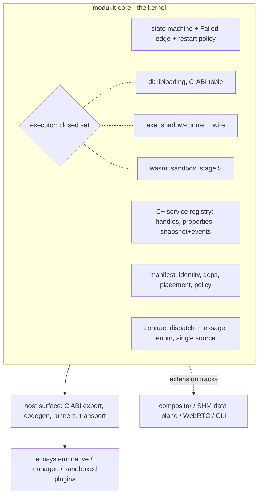

# ModuKit Architecture

**Status**: adjudicated engineering baseline (2026-10-10; D56-D63 added 2026-10-13; D64-D73 added 2026-10-15). Where this document differs from the
[whitepaper](whitepaper.md) v1.0 vision text, the delta table in §9 is authoritative and the
whitepaper remains canon for naming (§2.3) and principles (§3) not amended here.
**Provenance**: architecture questions were adjudicated one-by-one with the maintainer
(placement hybrid, availability grade in-vehicle-B, service model C+, solo+AI thin Stage-1
cut), recorded as D2-D5 in `.agents/memorys/decisions.md`.
**Deep dives**: numbered documents in [modules/](modules/00-overview.md).

---

## 1. Overview

ModuKit is a modular plugin host framework: in-process and multi-process plugin lifecycle,
type-safe service registry, one C ABI as the sole cross-language exit, and optionally a
multi-process UI composition / zero-copy / WebRTC extension stack (whitepaper §1).

The beachhead that shapes the first years is a family of projects starting with
an in-vehicle / large-screen HMI (Linux-primary, desktop-style form factor; UI modules,
business logic and device access all intended to be plugins), later tool-class products and a
cross-platform foundation. Nothing exists to migrate; the framework starts greenfield.
Year-1 plugin authors are trusted internal C++/Rust; polyglot and third-party plugins come
later — the ABI and the placement model are designed now, the per-language runners and
sandboxing are implemented later.

## 2. Design principles

Inherited (whitepaper §3, unchanged): narrow core · C ABI as the single cross-language exit ·
capability declarations beat assumptions · extensions opt-in · unified in-process /
multi-process model.

Added by adjudication (2026-10-10):

1. **Placement is a deployment property.** The executor set is closed {dl, exe, wasm}; the
   plugin ships one artifact; switching placement must not require code changes (D2).
2. **Language is an orthogonal axis.** JS/TS/Lua/Python are runners + generated SDKs, never
   new core mechanisms (D2; three-layer strategy per D33 - engine-run handwritten languages,
   IR-lowered graph languages bridging the AUDESYS hal-ir VM, editor-only blueprint frontends).
3. **Switchability is a tested property, not a documented wish.** A plugin may claim
   dl/exe-switch only after the contract suite passes under both placements (D2).
4. **The abstraction never lies about asymmetries.** Crash blast radius and IPC cost differ
   by placement and must remain visible in the API surface (D2).
5. **Structure is one-shot, vocabulary is incremental.** The service object model is frozen
   for future OSGi-grade additions (handles, properties, events, ranking, acquire/release
   shapes); the dynamic vocabulary (LDAP/tracker/factory) ships only when a placement-verified
   need exists (D4).

## 3. Layered architecture



The whitepaper's four-layer view stands; what changed is that placement (executor) is now a
first-class kernel concept rather than a host-layer detail, and script/`*-bindings` crates are
reinterpreted as the language axis (§4).

## 4. The two axes

| Axis | Cardinality | Defined by | Year-1 members |
|---|---|---|---|
| Placement (executor) | closed set | the kernel | `dl`; `exe` interface only |
| Language (runner) | open set | the contract + codegen | Rust; C/C++ via C ABI |

Exe placement uses a **shadow runner**: the host spawns a generic
`modukit-run <plugin.so> --fd=N` child that `dlopen`s the *same artifact* and serves the wire
transport on the inherited fd. Precondition list, switch rules (`dl -> exe` free;
`exe -> dl` vetoed by trust tier) and the permanent asymmetries:
[modules/01-plugin-placement-model.md](modules/01-plugin-placement-model.md).

Industry anchors (repo profiles): dora operator/node same-contract
(`docs/reference/dora.md:48-52`), ipc-channel inprocess+cross-process backends
(`docs/reference/ipc-channel.md:14,96`), CLAP handshake (`clap-plugin-abi.md:26-37`);
VST3 Gateway and ROS2 components are industry knowledge, not repo-verified.

## 5. Contract and service model (summary)

Service interfaces are defined once and generate the C-ABI table (dl) and the serde wire
(exe). Dispatch is a message enum × transport; local transport may skip serialization but not
the message shape. Six invariants (handles not instances; monotonic registration ids;
case-insensitive properties; reserved ranking; snapshot+delta events; acquire/release call
shape) make later OSGi-grade vocabulary purely additive. Dependency declarations live in the
manifest with per-dependency consumer policy `wait | failfast | fallback`; LDAP, trackers,
factories and per-bundle leases are explicitly not implemented in year 1.

Boundary calls are synchronous or job-tokened with event completion (D6) — no
language-level async crosses the ABI. Deep dive:
[modules/02-service-model.md](modules/02-service-model.md),
[modules/04-contract-and-codegen.md](modules/04-contract-and-codegen.md). (D4/D6) Topics are the
second object kind of the same handle table (D10, modules/06); byte movement is vendor-swappable
only behind a narrow transport seam (D11, modules/07). The ledger is authored directly:
hand-written `.proto` is the single contract source; Rust skeletons, the C ABI and `fdset`
are its generated faces (D13).

## 6. Lifecycle and availability (summary)

Six-state OSGi-style machine plus a `Failed` edge; supervised restart with manifest-declared
policy `{none | on-failure, max_retries, backoff, cooldown}` — belonging to process placement;
under `dl` a C-UB crash is host-corrupting and the state machine says so. Boot is tiered and
parallel (`start_level` + dependency-respecting ordering). High-rate hardware data planes
(e.g. CAN-style streams) never traverse the plugin service bus: ModuKit owns orchestration,
not microseconds. Availability grade: in-vehicle engineering tier — no hard real-time
promises, no functional-safety certification surface; watchdog/ASIL integration is a system-
layer neighbor, not a kernel feature. Deep dive:
[modules/03-lifecycle-state-machine.md](modules/03-lifecycle-state-machine.md). (D3)

## 7. Trust tiers -> placement mapping

Replaces the whitepaper §6.4 prose (delta §9):

| Tier | Who | Placements | Enforcement |
|---|---|---|---|
| Trusted native | internal Rust/C++ | `dl` default, `exe` on deploy choice | full API |
| Semi-trusted script | internal Lua/JS runners | `exe`-hosted runner; `dl` only under review | restricted API surface |
| Untrusted third-party | vendors, marketplace | `exe` minimum, `wasm` default | sandbox, resource caps, switchability preconditions enforced by the host, not advised |

Host policy may force a *more* isolated placement, never a less isolated one.

## 8. Workspace and crate plan

Unchanged namespace authority (whitepaper §2.3); reinterpretations per §4:
`modukit-script-*` and `modukit-py/-cs/-js` are runner/SDK packages, `modukit-c` remains the
C ABI export, `modukit-wasm` is the third executor.

Plugin build-to-bundle (D55): `modukit build` (first-class, split from the D23 wagon) detects the author's build system, compiles into a temp area, assembles the standard bundle layout (modukit.toml + artifact + lib/ + vendor/ + resources/), locks $ORIGIN RPATH, collects dependencies, content-addresses >1MB files into `.modukit/objects/<hash>` with bundle hardlinks (Docker/Nix/ostree-style dedup; read-only bits + load-time re-verification), emits the hash manifest - output installs via D28 directly. Dependency privatization: private deps build in; OS base libs from a documented whitelist; third-party .so per-bundle in lib/ (OpenCV 3 and 4 coexist); venv/node_modules in vendor/; no version ranges (privatization removes negotiation). The framework is a PACKAGER, never a builder; duplicate-id rejection (D34), blue-green via host_ids (D37), parallel_ok valve (Stage-2) unchanged; setup.bash-style env chaining deliberately absent (host computes its own paths).

ROS 2 via pixi (D56-D60): net-listen grammar gains port ranges + multicast joins (DDS discovery declared, no new word - D56); pixi/conda environments ride class four into vendor/ with pixi.lock as the pin, activation = static injection default + ring-audited activate-script escape hatch, the host never runs bundle-borne shell (D57); modukit build executes author-declared recipe strings, ecosystem knowledge lives in templates (D58); ROS_DOMAIN_ID/RMW_IMPLEMENTATION/ROS_LOCALHOST_ONLY are site facts in deploy-TOML [ros2], host_id logic for the network domain (D59); rclcpp stop_timeout recommended override 3s, the host stays middleware-illiterate by construction (D60).

Foxglove interop (D61): the D16 recorder stays ours over the neutral mcap crate (foxglove-sdk never enters the recording path); a bridge plugin embeds the foxglove-sdk WebSocket server so the app connects unchanged with all stock panels lit; writeback crosses as an ordinary client through the existing gates (no debug exemption, D44); type-mapping tables are per-bridge (D11) with a dictionary-pack promotion trigger at the second ecosystem; foxglove-sdk is bridge-plugin-only (never the host link domain); Foxlet/Data Platform upload is site-side.

Build orchestration (D64-D67): PolyOrch is adopted as the repo build-orchestration layer by immediate policy (D64); the physical gitlink submodule lands at a maintainer-called moment. Environment split (D65): mise owns host/agent tooling and carries no build-reproducibility promise; pixi owns build-time environments with a committed `pixi.lock` as the pin (`polyorch_rust_setup(FROM pixi)`, `FROM system` kept as escape hatch) - the build-side mirror of the D57 deploy doctrine. At landing the root carries a full-shape CMake assembly modeled on VisiaEngine (D66): five-part order, `cmake_minimum_required(3.25)` embed floor, `crates/` stay pure Cargo under zero-intrusion (CMake drives native engines, PolyOrch-generated files never enter bridged directories), binding lanes + examples + install/export ride the single root graph, IDE project files are insight projections only. The submodule gitlink is the single version authority (D67): no branch tracking, no second ledger, bumps as standalone auditable commits; host-language artifact naming (`LANGUAGE_PRODUCT`) and version single-source from the workspace `Cargo.toml` are adopted; the cxx+cbindgen two-surface FFI model is refused - the D63 floor stays the single projection, with cbindgen kept as the header emitter inside our pipeline.

Media-server base (D68-D73): when serving a media server the posture is the CONTROL-PLANE base - kernel owns lifecycle/registry/manifest/supervisor/ABI governance; the pipeline core stays compiled; GPU inner loops are core, never plugins (D68). The frame clause (D69): frame bytes reach any plugin only via the pool + descriptor channel; contracts pass handles/descriptors/registration ids, never raw pointers or foreign malloc'd buffers; a dl plugin mapping the pool is a trusted-tier privilege; SDK consumers take frames over API borrow/pull/out-buffer. Node factories (kind+formats+priority queries) ride plugin contracts, not the registry; observable work units register ephemeral records and deregister on completion (D70). Multi-instance coexistence stays inert - base swaps ride the exe-restart and dl-next-boot lanes; the doorbell is drawn and rechecked, not rung (D71). Capability vocabulary audited sufficient; device entrances ride resources{} + vendor notes (D72). MediaServo integration: declared intent, NOT wiring - parallel until the kernel API stabilizes, direction library-first when the day comes (D73). Doctrine card: `docs/modules/11-media-server-base.md`.

Companion type packs (D45): `modukit-types-<domain>` packages (first candidates:
vision - camera frames aligned with I420 vocabulary and D15 lanes; motion - IMU/odometry
aligned with D20 capture_ts discipline). Plain `.proto` packages riding every existing
gate (D12/D13 versioning, sentinels, fdset, codegen), opt-in by authors, declared as
provides/requires under D7 - the kernel never embeds them (whitepaper 6.1 red line intact).

Stage-1 deliverable shape:

```text
Cargo.toml                 # workspace, resolver 3, edition 2024
crates/modukit-core/       # state / manifest / registry / contract / executor{dl,...} / errors
test-plugins/example-plugin/  # cdylib fixture, ABI v1 (test shelf; plugins/ = production)
test-plugins/bad-plugin/      # negative fixture, ABI mismatch
```

Kernel-v0 (2026-10-10 experiment, parked by maintainer decision) validated the six-state
machine, Any-typed registry, libloading path and the dlopen integration-test harness
(cdylib artifacts must be built explicitly in-test). Three surgery points on resumption:
executor-trait seam, `Failed` edge, message-shaped service API. The parked backup is outside
the repo and transient (session memory records its path); do not treat its existence as a
repo fact.

## 9. Delta table vs whitepaper v1.0

| Whitepaper claim | Adjudicated state |
|---|---|
| §4.4/§6.2 "main HMI acts as compositor; child processes submit I420 frames" (a commitment) | demoted to extension/research track; sequencing per §12 |
| §6.1 "Crash isolation: a child-process crash does not affect the host" | kept, but scoped to process placement; `dl` documents no such guarantee (D2/D3) |
| §6.4 trust-tier prose | replaced by the placement-mapping table §7 |
| §4.1 "type-safe service discovery and dependency injection" | operationalized as C+: static binding + dynamic events + six invariants (D4) |
| §5 rows `modukit-script-lua` / `modukit-script-js` / bindings | language-axis runner packages, not core mechanisms (D2) |
| §8 stage ordering | deltas in §12 |
| principle "unified in-process / multi-process model" (§3.5) | implemented as the two-axis model (§4) |

## 10. Stage-1 scope (builder mode: solo + AI, demo-driven)

**In (built and tested)**: state machine incl. `Failed` + policy types; manifest v0
(fields settled, format TOML per D7); C+ registry (handles/properties/ids/events/snapshot,
acquire/release shapes); contract codegen v0 (Rust trait -> dispatch, local transport,
shapes locked;
`.proto` source + protoc plugin emitting Rust skeleton/C ABI/fdset, golden-file + regen-diff gates per D12/D13); `DlopenExecutor`; example/bad plugin fixtures; dlopen integration tests;
the contract suite structured for later dual-placement runs; the minimal in-process topic bus
with `latest-value` QoS (D10); the transport seam trait plus its local socketpair/memfd and
dummy test-double backends (D11); the descriptor access protocol and two-stage
retrieval API shape (D14, 07 §3-4); the introspect trio + `ModuleLoaded` event + the three
acceptance tests (D17, modules/10 — read-only services, zero UI); the live edge ledger + `Snapshot.edges()` (D18, ~100 lines); the logger service with `LogEvent` in the shared ring (D19, modules/10 §5); the unified clock service with timers-as-jobs (D20, modules/03 §6); gate counters on the same doorways (D21, modules/10 §6.1); template standing of the example/bad fixtures (D23); the `test-support` testhost face (D24, modules/10 §3.1); `org.modukit.runtime.proto` (kernel error enum + shared Error body) as the first ledger-native vocabulary (D27); the logical-bundle install protocol (staging -> hash/cross-check -> atomic rename; D28).

**Out (interface only or absent)**: ProcessExecutor implementation, shadow-runner binary,
LDAP/tracker/factory/leases, all language bindings, compositor, SHM data plane, external
C-ABI export freeze, watchdog/safety surface, OTA/bundle distribution, CLI; cross-process bus wiring and any vendor pool/carrier linkage
(bridge plugins per D11 arrive when a real foreign graph does); recorder/replay implementation
(design recorded in modules/09, D16 — Stage-2 tooling).

**Accepted risk (declined by choice)**: no external-consumer validation round before the
contract freezes — C+ invariants stay unverified until the first non-kernel plugin touches
them. Re-review trigger recorded in D5.

## 11. Decisions

| ID | Subject | One-line |
|---|---|---|
| D1 | license | MIT OR Apache-2.0 dual (2026-10-09) |
| D2 | placement model | unified plugin, closed executor set, shadow-runner, tested switchability |
| D3 | availability | in-vehicle B tier: start levels, consumer policies, backoff restart; no hard RT |
| D4 | service model | C+: static binding + dynamic events, six B-compatible invariants, vocabulary reserved |
| D5 | Stage-1 cut | solo+AI thin edge; three v0 surgery points; long out-of-scope list |
| D6 | async model | synchronous boundary + job tokens + event completion; await is runner-side sugar; actor messaging as exe transport mechanics only |
| D7 | manifest residence | three tiers (deploy TOML / self-report descriptor / stage-5 binary verification) + mandatory cross-check with liar fixture |
| D8 | update semantics | stop-based (dl: activate-on-host-restart; exe: swap in restart cycle); `parallel_ok` declared escape hatch, routing ships Stage-2 |
| D9 | service identity | canonical reverse-DNS strings in properties; typed consts; bundle-scoped manifest aliases as sugar only |
| D10 | topic bus | four-kind object table (service/job/topic/descriptor); latest-value default QoS, three commandments; recorder/debugger as plain subscribers |
| D11 | transport architecture | kernel owns semantics; vendors swap behind a ~10-method seam; per-plane simultaneous slots; foreign middleware via bridge plugins, never a core swap |
| D12 | contract registry | hand-written-numbered `.proto` family + `fdset` ledger (regen-diff gate, three registry rules); envelope/cargo two lanes (Arrow sidecar framing) — authoring door revised by D13 |
| D13 | contract door | `.proto` authored directly = single source; protoc plugin emits Rust skeleton/C ABI/fdset (no exporter); kernel-internal types never enter the ledger; gRPC still out (substrate ≠ authoring) |
| D14 | descriptor access | self-sufficient tokens (slot/epoch/layout); attach-once pool transfer via UDS; borrows + EPOCH_EXPIRED liveness; two-stage retrieval (cheap meta, lazy data); carrier = deployment property, never type property |
| D15 | cargo oneof | two mutually-exclusive arms (local ticket / off-host tail, tag 1000); bridge exchanges ticket->tail; three-sheet definition law (type/ticket/deployment); pixels never enter .proto |
| D16 | recording & replay | recorder = ordinary export-gated subscriber (deep probe rejected); three-part self-describing header; gap stats as honest absence; replay = virtual publisher (content deterministic, timing not); mcap-first with own-format fallback |
| D17 | observability & debugging | introspect trio (ledger/snapshot/eventstream, trust-filtered) + ModuleLoaded event; churn/replay/ledger equality acceptance tests; DAP = off-the-shelf adapters for native, runner hook for scripts (Stage 5); Foxglove compat as D16 acceptance; zero bespoke UI/protocol in kernel |
| D18 | edge ledger & analysis | live (caller,service,method) counts at the stub doorway + declared ledger => graph/callers/impact/orphans/diff as pure walks; undeclared use = warn by default, reject is a policy knob |
| D19 | logger | kernel logger service acquired like any service; LogEvent joins the shared monotonic ring (identity/level/kv/seq) so sinks are subscribers, replay narrates, OTLP is a future sink — kernel never depends on OTel |
| D20 | clock & timers | one time source (`now` + timer-as-job) across real/sim/step domains; kernel timers ride it; replay turns the dial; hot paths use message `capture_ts`; interception and test-mock alternatives rejected |
| D21 | gate counters | edge latencies + topic rates/high-water as atomic adds at already-adjudicated doorways; read via Snapshot + CountersTick ring events; quantiles and OTel pushed downstream (P2 subscribers) |
| D22 | resource books | exe-only accounting (supervisor sampling + wait4; Snapshot fields; ResourceTick on the ring); dl entries say n/a honestly; quotas (cgroup/rlimit) deferred to first-untrusted-vendor trigger |
| D23 | scaffolding | example/bad fixtures hold template standing (changes = compatibility-weighted doc acts); `modukit new` = Stage-2 CLI subcommand, ledger-driven, dialect-free; B-before-C order rule |
| D24 | testhost | public `test-support` face: in-process host + dummy transport + step clock + fold-checker + fixture feed; three-piece surface discipline; true-process e2e stays with the Stage-2 suite |
| D25 | pool backend | iceoryx2 first, exact-pinned stable tag (upgrades budgeted); self-built ring as trigger-gated fallback; slot=porters-only house rule (worldview vendors bridge-only); vendor vocabulary quarantined in the adapter |
| D26 | capability vocabulary | two namespaces: `org.modukit.*` hard-checked (opened at 8 words, one per adjudicated mechanism, list lives in the ledger; grown by later rulings to 13: +config-write D37, +control D44, +net-listen/net-connect/workdir D54); `com.vendor.*` soft self-registration feeding policy consumers (export/quota/trust) — notes, not keys |
| D27 | error model | two code spaces (kernel enum in runtime.proto; author-owned service enums under the sentinel rule), one shared record {code, domain, source, message, kv, hint}; hints feed D3/D6 policies, codes become D21 count dimensions; strings never decisional |
| D28 | bundle & install | logical unit (manifest+artifact+ledger refs+hash), directory/archive both on one pipeline; install = staging -> cross-check -> atomic rename; verification ladder hash(now)/signature(untrusted trigger)/repository(OTA trigger), format & rollback deferred with owners |
| D29 | configuration | schema in the plugin's own .proto (D13 door), values in deploy-TOML verified by the D7 cross-check; change = restart (D8) by default; `config_live` declared keys opt into change events on ordinary topics, hot-lane spec trigger-gated |
| D30 | resources | bundle members (D28), manifest-declared + D7 cross-check; ResourceService window for exe/wasm/untrusted/archive; fd fast lane for trusted in-process dl only (same process, no boundary to break; exe excluded to keep isolation semantics + accounting intact); wasm-pack resource containers evaluated and rejected; compression = packaging-CLI concern, trigger-gated |
| D31 | resource tree & manifest format | directory-as-route (`resources/` tree IS the route table, single window prefix, no alias layer); checklist in the manifest `[resources]` section (same D7 envelope, tool-fillable comment-preserving; separate .idx rejected); manifest format = TOML (INI/JSON/YAML rejected on deployment-floor grounds) |
| D32 | dependency graph tool | three views over the D18 ledgers (`graph --view declared|observed|diff`, diff default); year-1 minimal analyzer bin (dot export); full CLI subcommand on the Stage-2 wagon; live animated view trigger-gated (plugins > 20 or second team) with fixed shape: browser page as ordinary EventStream client, Foxglove-stock-panel first, cytoscape.js single-file fallback; never framework-embedded/wasm-frontend/hand-rolled layout |
| D40 | extension points, drain, team tag | platform extension points = pre-registered platform service interfaces (host is an ordinary consumer; no second channel); side-effect deps modeled as services; key-value blackboard rejected; STOPPING drain = refuse new / finish old / stop_timeout bound (industry-converged); start-approval hook named trigger-gated; manifest `team` label for audit/accounting aggregation only - no permission semantics (D37 RBAC stands); org-level platform mode never self-built; OSGi verdict: lacks are deliberate rejections or filed triggers |
| D42 | tag semantics | TagEnvelope template in modukit-api (D52) (value/quality/timestamp, generated counterparts; voluntary - bus never inspects); run-value downlink = ordinary publish through D26/D37 gates; config vs run-values = two lanes that never merge; deadbands = publisher discipline, bus stays dumb |
| D45 | standard domain types | companion `modukit-types-<domain>` proto packages (vision/motion first), opt-in, ride D12/D13 gates; kernel never embeds (no-business red line) - closes the ROS2/dora "no shared vocabulary" gap without a kernel type table |
| D46 | job progress discipline | one latest-value topic per JobToken (`org.modukit.job.<token>`); payload free, kernel routes not interprets; completion/cancel stay on D6 event path |
| D48 | protocol doc automation | three generated catalogs (config/services/topics) + TS types from the registry, regen-diff CI gate, version stamps; narrative docs stay hand-written |
| D49 | recording storage | tiered retention (debug/evidence/golden; evict lowest-oldest), quota budget from deploy-TOML with pause+alarm when exhausted (golden never overwritten), rolling ~256MB shards; userspace scheduler riding D16 |
| D50 | check gate | scripts/check.sh five fast local checks (fmt/clippy/test/C1/skill-lint, skip-when-absent) replaces dangling gate.sh refs NOW; coverage = llvm-cov staged (none -> 60% soft after first crate -> 80% hard); CI wired at Stage-1 revival with the same script; cargo audit rides CI |
| D51 | kernel error codes | 14 entries, all adjudicated-mechanism translations, four domains with RESERVED sentinels, never-reuse/freeze-deprecated - vocabulary instantiation of D27 |
| D54 | plugin capability surface | net-listen (port in deploy [net] listen, default loopback) / net-connect (separate word, optional allowlist) / workdir (one writable dir per plugin, boundary fixed, uninstall removes, corruption is plugin's business) - D26 vocabulary 10->13, applies to ANY exe plugin equally; napi-rs direction clarified: binding (JS->C ABI) never embedding; implementation at first Node/Web plugin trigger |
| D55 | build-to-bundle | `modukit build`: detect builder -> compile -> standard layout -> $ORIGIN RPATH -> dep privatization four classes -> >1MB content-addressed dedup -> hash manifest -> D28 install; framework = packager never builder; no version ranges; setup.bash chaining absent |
| D52 | SDK layout | modukit-api (types+macros+generated re-exports, seconds compile) / modukit-testing (dev-dep only, D24 face) / modukit-cli (standalone wagon) split; runtime machinery host-side, authors untouched; TS SDK from proto generation |
| D47 | failover pairs | hot standby free today via D4 ranking (rank = selection, not permission); cold standby named, trigger-gated (first degraded topology) - assembles only from stock parts (D3 Failed / D40 sibling gate / D33 lazy-activation form / D35 audit); general condition-startup DSL rejected (D38) |
| D44 | control panel & monitor ladder | manual lifecycle ops (start/stop/restart/reap; pause-publish trigger-gated) as ledger-native service - each op is a hand-cranked twin of adjudicated automations (D3/D34); gates: D37 identity + D26 org.modukit.control + every action (denied included) lands on the ring (D35); no second control channel; monitors press the same panel; ladder: year-1 `modukit status` + ctl, TUI `modukit watch` (ratatui) at the D32 bell, web bays at D39 |
| D43 | tag observation | tag table + trend curves = named bays of the D39 blueprint; history via `modukit history get` CLI tool reading mcap (D16/D23 wagon) - no resident history in host (D17); tag breakpoints = debugger domain (D17); value-triggered action = watchdog plugin, never a rule engine (D38); first-step single-tag trace = introspect query, full causal chains trigger-gated |
| D41 | DSL bridge (port) | hal-ir PORTED as first-class ModuKit crates at bridge-trigger day (NOT vendored verbatim - maintainer correction: absorb the code, rename to modukit naming/structure/conventions, own it as our crate; provenance note states AUDESYS origin commit); survives upstream death by being OURS outright; bridge wrapper separate (~500 lines); three wrappers carry from the C design (exe-runner step-clock / wasm VM / topics IO / ring observability); trigger = first industrial customer |
| D39 | unified web-admin blueprint | seven-section IDE-skeleton+cockpit-bay design (plugins/communication/services/debugging/logs/audit/settings) as the D37 hearing exhibit; shell=Svelte 5, bays=separate-page static packages; data law: three protocols only (introspect/EventStream/ConfigService), web produces viewports not data, host untouched; multi-host switcher (D36); trigger ladder D32-bell -> read-only three sections -> debugging bay -> ops team -> Loki -> compliance export; zero year-1 work |
| D38 | Cordis/DSH study adoptions | `modukit config dump` (layer-annotated effective tree), id-addressed overlay patches, structured validation-failure format (D27 body), "minimal" as named product profile, plugin-settings UI folded into cfg-web hearing, generated config-catalog docs (D23 candidate); config never mounts code (DSH cautionary - contract door protected) |
| D37 | config layout, ConfigService, web admin | per-host file tree (runtime/deploy/overlay + bundle manifest), precedence overlay>deploy>defaults, effect atomic unit = startup of what it describes (no file watching, no half-applied); multi-version: missing->default, stale->warn, type->fail, migration = author's job; hot-lane ConfigService (set gates: schema+constraints+live-key+capability; atomic snapshot swap; async overlay write-back keeps file as truth); thin RBAC (bridge-declared identity, role-x-prefix in runtime.toml, no accounts year 1, ABAC trigger-gated); web admin: read = D32 tabs, write = files+git only, full admin = standalone tool hearing (AccessBase: format reference only, external-authority mode = candidate); stack when built: Svelte 5 forms + Monaco/react-flow IDE cabin, Grafana/Loki never self-built, never in host |
| D36 | host identity & communication boundaries | deploy-level `host_id` (default hostname, collision warning); contract names untouched (D9), cross-host = `host_id/name` door-plate composition; resolution local-first, cross-host explicit; runtime renaming rejected (D13); boundaries = name discipline (component prefixes / unqualified fleet-wide / app-prefix clusters), zero machinery, hard group permissions behind multi-vendor trigger |
| D35 | boundaries: gates/audit, no gateway, cluster | checks stay at their own gates, decisions land on the observation ring (audits = ring walks; callback into lower tier passes its gate); ModuKit has no gateway - cross-world = bridge plugins, external entry = bridge plugins, central policy = more bridges never a kernel component; cluster identity: per-machine sovereignty (autonomy = partition resilience) + carrier-transparent cross-machine calls (D14) + fleet orchestration belongs to the orchestrator (manifest + idempotent install are the cooperation surfaces); no logical multi-machine host |
| D34 | shutdown budget & host lifecycle | stop_timeout per plugin (default 2s; expiry per placement: exe SIGKILL / wasm cancel / dl mark-FAILED-and-move-on); host lifecycle in three statements (boot DAG cold start; graceful shutdown = reverse order + budgets + total cap with unclean exit code; self-healing = OS service manager, host cooperates via exit-code vocabulary + crash testament); capability freeze at install (restart IS revocation); duplicate-id rejected; rate limits & access control & state handover named trigger-gated |
| D33 | language strategy | three layers with one dividing line - handwritten languages (Lua/JS/TS/Py) run on their own engines in exe-runners (no determinism promise); generated/graph languages (ST/IL/LD/FBD/SFC, future blueprint/G frontends) all lower to the AUDESYS hal-ir VM (bridged, same-maintainer asset; scan cycle maps to the D20 step clock; VM is Rust and can enter the wasm tier - the only DSL path into the untrusted sandbox); blueprints = generalized FBD frontends emitting IR (script downgrade = editor export option only); never self-built script engines, general VMs, or the full LabVIEW scheduler; first-layer runners trigger on first real plugin need, runner skeleton extracted at the second runner. Platform matrix (adjudicated 2026-10-12): the product backs exactly two artifact forms - native engines (exe-runners) and wasm components/IR - and platform reach follows artifact form: TS/JS (compile to components via jco/ComponentJS) + Rust/Go components + the hal-ir VM@wasm cover every platform including the untrusted tier and the browser; Lua (LuaJIT) and Python (CPython/PyO3) are native-only by design - no wasmoon/Pyodide support now, revisit only if a real need materializes (D33 trigger); untrusted Lua/Py demand redirects to TS/JS or Rust components; browser page authors may embed whatever they like, but ModuKit neither provides nor tests nor supports script engines in wasm (three-nos)
| D56 | ROS 2 DDS network exposure | net-listen grammar + port ranges + multicast joins (DDS discovery 7400-7600 / 239.255.0.1), no new word - D54's value-grammar clause exercised; coarse per-middleware words rejected |
| D57 | pixi/conda environments | D55 class four -> vendor/ (pixi-pack output, pixi.lock = the pin); activation = static injection default + activate-script opt-in escape (wrapper in the plugin process, ring-audited); host never executes bundle-borne shell |
| D58 | build recipe delegation | modukit build runs author-declared command strings (modukit.toml [build]); ecosystem knowledge lives in D23 templates, never the framework - packager law extended |
| D59 | ROS site settings | ROS_DOMAIN_ID/RMW_IMPLEMENTATION/ROS_LOCALHOST_ONLY in deploy-TOML [ros2]; host_id logic for the network domain; one host one domain, host-guaranteed; bundles carry no runtime values |
| D60 | ROS lifecycle + discipline | stop_timeout 3s recommended rclcpp override (suggestion, D34 unchanged); ROS knowledge lives in templates/recipes/declarations - host middleware-illiterate by construction |
| D61 | Foxglove interop | D16 recorder ours over neutral mcap crate; foxglove-ws bridge plugin (sdk WebSocket server embedded, app unchanged, panels lit); writeback = ordinary client through existing gates, no exemption; per-bridge mapping tables + dictionary-pack trigger; sdk bridge-only, never host; upload site-side |
| D62 | fallback semantics | error-carrying stub: ServiceRef stays callable, every call returns D27 record (SERVICE_UNAVAILABLE), never blocks never fabricates; stale-cache/default-map are consumer-side patterns (D46); absence counted in D21; required+fallback still fails boot resolve (D3) |
| D63 | bindings layering (A6 ratified, refined) | generated floor (hand-written substitutes forbidden), ergonomics fixed only in emitter templates, thin per-language sugar allowed above the floor (floor-only, semantics-free, fixture-tested); metadata-first ratified - .proto is truth, C ABI its generated projection |
| D64 | PolyOrch adoption | immediate-policy adoption (not trigger-gated): PolyOrch = repo build-orchestration layer; physical integration via git submodule, landing on maintainer call; runtime doctrine untouched |
| D65 | build-env split | mise = host/agent tools (no reproducibility promise); pixi = build envs, `pixi.lock` the committed pin via `polyorch_rust_setup(FROM pixi)` (`FROM system` escape hatch); mirrors D57 |
| D66 | root assembly layer | full VisiaEngine-shape CMake assembly at landing (five-part, embed floor 3.25); crates/ stay pure Cargo (zero-intrusion); lanes+examples+install on one graph; IDE files projections |
| D67 | PolyOrch pinning + doctrine | gitlink = single version authority (no branch tracking, no second ledger, standalone bump commits); adopt naming grammar (LANGUAGE_PRODUCT, -build mediators, version single-source from Cargo.toml); refuse cxx+cbindgen two-surface FFI - floor stays the D63 single projection |
| D68 | media base posture | control-plane P1: kernel = lifecycle/registry/manifest/supervisor/ABI governance; pipeline core compiled; GPU inner loop never a plugin |
| D69 | frame clause | frame bytes pool+descriptor ONLY, any placement; contracts carry handles/descriptors, no raw pointers/foreign malloc buffers; dl pool-mapping = trusted-tier privilege; SDK via API borrow/pull/out-buffer |
| D70 | factories + work units | kind/formats/priority query rides plugin contracts (registry invariants stand); drainable/countable work units register ephemeral records, deregister on completion |
| D71 | coexistence stays inert | parallel_ok routing inert; media-base swap needs ride exe-restart + dl-next-boot; doorbell: in-process hot-swap WITH in-flight tasks = fresh hearing |
| D72 | vocab audit | media needs covered; device entrances via resources{} + com.vendor.* notes; hard word only after adjudicated enforcement mechanism (D56 precedent) |
| D73 | integration posture | parallel, not wired: intent declared, kernel API stabilization is the gate; direction library-first when the day comes; C-ABI freeze trigger stays anonymous |
| D74 | clock-over-wire authority | supervisor owns the runner's Step/Sim dial on test/replay track (control socket, timeout guard); production Real; D17 test-2 lands as canon |
| D75 | external-consumer round paid | exe dual run = first non-kernel validation (friction log feeds D77); true third-party trigger stays alive |
| D76 | vendor-shm boundary | vendor only behind neutral non-default feature; one-module confinement; default-purity check + feature CI lane + dummy/vendor equivalence suite; core std-only |
| D77 | freeze hearing S2-M5 | door-by-door freeze (only exercised doors welded); D51-origin/integrity-codes/hint() IOUs as agenda; ABI bump policy |
| D78 | recorder+CLI supersession | D16/D17/D23 Stage-2 scheduling retired (design untouched); re-activation = real traffic + tooling demand; no mcap entry |
| D79 | coverage 80 hard at S2-M5 | workspace-wide, default features, same run as demo-stage2; codegen debt paid or exempted at hearing; anti-gaming clause |
| D80 | parallel_ok supersession+voice | routing mechanism deferred (typed deferral replaces silent ignore at the swap door, ~100 lines); D8 triggers stand verbatim |
| D81 | bus clause waits for the hearing | neither build-now nor silent bridge; IOU-5 carries ABI-v2-vs-bridge to S2-M5; D10 trigger honestly open |
| D82 | ABI v2 direction | publish/subscribe/schedule-timer admitted as first v2 residents; v1 frozen byte-identical; shapes NOT drawn (ruling 6) |
| D83 | ABI amendment policy | tail-add by record; modify/remove/semantic-change by hearing; effective today |
| D84 | coverage 80 split | bins boundary-exempt; core+codegen debt calendared to the Stage-3 kickoff gate; second-delay hook: features blocked until cleared |
| D85 | dictionary 14->19 | supervision domain tags 23-27 appended; INTEGRITY_FAILED at the bundle tier; hint() shipped |
| D86 | door-front cleanup | hint() paid; probe reads-as-dl/verifies-at-HELLO promoted to rule; native-exe admission refused |
| D87 | FREEZE declaration | v1 surfaces STABLE (host table, wire v1, install protocol, supervisor verbs, proxy face, dictionary); v2 PLANNED signage |
| D88 | Stage-2 accepted | five-point DoD all green; closed 2026-10-18; Stage-3 scoping on maintainer word |

_(Index note: D53 carries no ruling - reserved during the 2026-10-12 doc-audit F1 discussion, tombstoned in the ledger; see `.agents/memorys/decisions.md`.)_

Full records: `.agents/memorys/decisions.md`.
Queue closed 2026-10-13 (nothing silently dropped): JS dual-product-face settled by
D33/D51/D54; capability-vocabulary design pass settled by D26/D56; header-first vs
metadata-first ratified by D63 (metadata-first); `fallback` semantics ruled by D62
(error-carrying stub). Remainder is trigger-gated, not discussion-gated: C-ABI export
freeze timing (before first external binding consumer), external-consumer validation
round (Stage-2 onward; `docs/reference/00-overview.md` §4).

## 12. Roadmap (amended §8)

1. **Stage 1** — in-process kernel per §10 (unchanged in spirit; C+ semantics from day 1).
2. **Stage 2** — process placement: supervisor, shadow-runner, wire transport; executor
   interface itself ships in Stage 1. Zero-copy plane follows the open decision sheet
   (`docs/reference/00-overview.md` §2 — iceoryx2 local + Zenoh carrier; the *form* is adjudicated
per D11, only backend/vendor selection remains open).
3. **Stage 3** — multi-process UI composition: extension/research track (demoted; revisit with
   the beachhead's real UI demands).
4. **Stage 4** — remote WebRTC: unchanged; engine-tiering canon question still queued.
5. **Stage 5** — polyglot ecosystem on the language axis; the JS dual-face product decision
   is scheduled here.

## 13. Module documentation index

| Doc | Subject |
|---|---|
| [modules/00-overview.md](modules/00-overview.md) | index and reading order |
| [modules/01-plugin-placement-model.md](modules/01-plugin-placement-model.md) | placement model: executors, shadow-runner, asymmetries, host lifecycle, cluster identity |
| [modules/02-service-model.md](modules/02-service-model.md) | C+ registry semantics and invariants |
| [modules/03-lifecycle-state-machine.md](modules/03-lifecycle-state-machine.md) | states, Failed edge, boot orchestration |
| [modules/04-contract-and-codegen.md](modules/04-contract-and-codegen.md) | single source, two transports, handshake, bindings layering (D63) |
| [modules/05-manifest-and-deployment.md](modules/05-manifest-and-deployment.md) | manifest + deployment: capabilities, bundles, resources, config, build-to-bundle, ROS 2 pixi lane |
| [modules/06-topics-and-bus.md](modules/06-topics-and-bus.md) | object table, topic QoS, tags discipline, instrumentation taps |
| [modules/07-transport-architecture.md](modules/07-transport-architecture.md) | transport seam, slots, descriptor law, bridges incl. foxglove-ws |
| [modules/08-end-to-end-walkthrough.md](modules/08-end-to-end-walkthrough.md) | end-to-end worked example: one video frame across all layers |
| [modules/09-recording-and-replay.md](modules/09-recording-and-replay.md) | recording, replay, container policy |
| [modules/10-observability-and-debugging.md](modules/10-observability-and-debugging.md) | introspect trio, logger, edge ledger + analysis, debug lanes, tool constitution |
| [modules/11-media-server-base.md](modules/11-media-server-base.md) | media-server base doctrine card (thin; pointers only) |

## 14. Appendix: reference projects

Profiles live in `docs/reference/` (index: `00-overview.md`; count deliberately not quoted -
volatile counts rot, the index file is the authority). The ones load-bearing for
this document: CppMicroServices (state machine + service semantics mirror; also the cautionary
"no remote story" — `cppmicroservices.md:80`), dora (same-contract two placements),
ipc-channel (one API, inprocess+cross-process backends, weight accounting), CLAP (handshake
shape), rutis (dlopen pitfalls + declared non-goals), zellij (contained-crash presentation),
CTK (15-year edge-case ledger). Whitepaper citation audit:
`whitepaper-cited-unvendored.md`.
