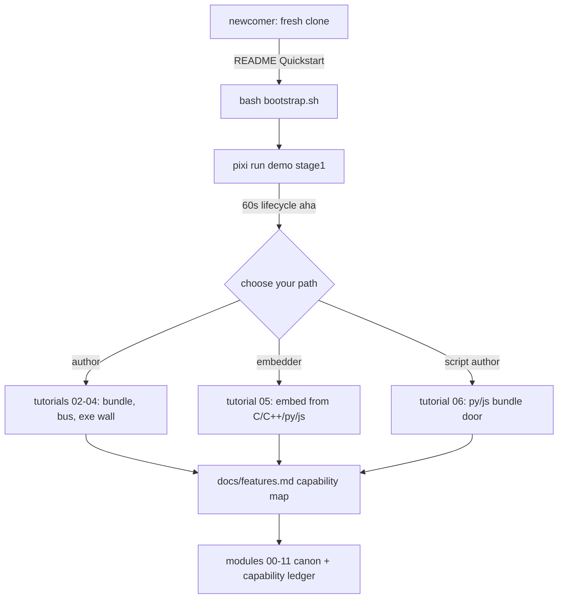

# Developer-onboarding plan - tutorials, examples, bindings, discoverability

> STATUS: PLAN OF RECORD, 2026-11-24 (revision 5 - rev4 + the recurring-proof
> amendment: the new C artifacts ride the existing m1 leg for nightly
> regression; the fenced-command automation direction is recorded
> trigger-gated). Drawn
> from a four-lens expert panel (correctness / evidence / docs /
> developer-experience, frozen lenses, merged with preserved disagreement)
> plus a community survey of five local-clone donors (CppMicroServices, celix,
> CTK, dora, and the in-repo PolyOrch precedent). Maintainer direction: make
> it easy for a user to quickly learn the usage and to discover ALL features,
> functions, use cases, and patterns across the multi-language bands
> (C / C++ / Python / JS). Adjudication points A1-A6 walked one by one and
> ALL RESOLVED (2026-11-24; A1 = B-expanded by maintainer requirement: the
> full 3x2 host+bundle matrix ships in v1); execution-ready, W0 first.

## 0. Discussion anchors

### 0.1 Panel-verified diagnosis (not "we have no examples")

- The real gap is TWO-LAYER: (a) a content gap - no bundle-AUTHOR-view zero-to
  running path (today's examples/ are host-side gate walkers); (b) a
  discoverability gap - README has no quickstart heading and never links the
  book; docs/env.md "three steps" is environment-facing, not pedagogical.
- The ASSETS already exist: 13 standing demo legs (replayed by CI nightly -
  natural anti-drift teaching material), the 84-line clean author-side
  `cpp-example-bundle`, D23's "template standing" fixtures ruling, and the
  sabotage levers (`DEMO_STAGE4_SABOTAGE=1` - a ready-made "watch the gate
  refuse a bad manifest" teaching device).
- Live bugs the panel caught for free (fix regardless of this plan):
  README still says 24 verbs / 16 rung-0 (actual 25 / 17 after the S1
  tail-add); demo-wave2-py's SKIP copy says "under out/" (territory moved to
  build/) and does not point the user at m1; README/bootstrap claim macOS
  while `pixi.toml` platforms are linux-64/win-64; no `pixi demo-*` one-command
  task exists.
- The "same story across bands" acceptance criterion was REWRITTEN by the
  panel: Python bundles ride the exe wall + TL wire, a different world from
  dl + C ABI. The honest framing is "one business domain, two mechanism
  narratives" - never fake a Python bundle by driving the cpp .so from a py
  host.
- Four hidden contracts for script bundles must be taught explicitly: the
  manifest `runner` must be an ABSOLUTE existing path; a bundle subprocess
  must NEVER print (fd 0 is the control channel); `MODUKIT_PY_SKIN` must point
  at bindings/py for out-of-tree bundles; generated skins are DO-NOT-EDIT
  (D63).

### 0.2 Community survey (local-clone-verified)

| Project | Shape | What we borrow / reject |
|---|---|---|
| CppMicroServices | Progressive tutorial: dictionaryservice -> consumers v1/v2/v3 -> spellcheck -> eventlistener; Example1-7 chapters + getting_started.rst; code lives beside chapters | Borrow the PROGRESSION spine (naive consumer -> tracker -> filter maps onto our S1/S2); reject the dictionary domain (we are a bundle HOST; echo/sensor family is ours) |
| celix | documents/ topic pages (framework/components/services/patterns/properties_and_filter) + a separate bundled examples tree | Topic pages ~ our modules 00-11 already; separate examples tree would drift - reject |
| CTK | Documentation/ dir, doxygen | Nothing new for us |
| dora | examples/ with SCENARIO-named dirs (python-dataflow, c-dataflow, rust-dynamic-add-remove, multiple-daemons...) each with a README | Borrow scenario-naming for future example volumes; but our v1 rides existing legs rather than minting parallel scenarios |
| PolyOrch (in-repo submodule, shape precedent only) | docs/tutorials.md single-file learning path: "who this is for" 3-reader routing + numbered chapters, every command proven by the repo's own tests | Borrow the 3-reader routing and the "every command is CI-proven" covenant verbatim in spirit |

Consensus across donors: tutorials live WITH the docs source (so they build
and gate), example code lives where CI compiles it, and no donor maintains a
docs-only example that nothing compiles.

## 1. Goals (three user journeys)

1. **First 15 minutes**: fresh clone -> one command -> watch a full bundle
   lifecycle (install, resolve, start, service call, late-join, uninstall) -
   with copy-paste that works on Linux/WSL and honest platform notes.
2. **First bundle per band**: an author writes and runs their own bundle in
   C++ (dl), Python (script/exe), JS (script/exe), or embeds the host from C
   / C++ / Python / JS - knowing the four hidden contracts up front.
3. **Full capability map**: one page answers "what can this thing do and
   where do I see each capability run" - every shipped feature (25 embed
   verbs, filter/tracker/DM-lite/ConfigAdmin, bus v2 + clock v3 + push,
   supervisor, observability) mapped to its demo leg, module doc, and
   binding face. Counts link the capability ledger, never hardcode.

## 2. Scope and OUT

IN: W0 quick fixes; W1 tutorial suite (6 chapters + index); W2 discoverability
triple; W3 examples-as-code hygiene (manifest sample, band contracts doc,
examples/ pointer README that only routes); W4 feature gallery page; W5 book
integration. OUT: new product features; new CI legs
beyond the doc-refs one-line extension; the video-frame domain (module 08 is
design-only - teaching it would teach something that cannot run); a config
hot-lane chapter (S3-2 has no demo leg yet - canon link only, chapter waits
for its leg); i18n translations (book is English-source by D46; readers use
browser translation).

## 3. Adjudication points (ALL RESOLVED 2026-11-24)

| # | Question | Recommendation |
|---|---|---|
| A1 | C band: mint the first C bundle fixture (`test-bundles/c/`, rides cmake + census = a real CI-face change) vs embed-C-only chapter (zero new surface) | **RESOLVED B-expanded** (2026-11-24, maintainer requirement): the FULL 3x2 matrix ships in v1 - host/embed AND bundle faces in C, C++, AND Python. New cells: `examples/c/host_demo.c` (embed verbs; links the STATIC `modukit-core-static` handle exactly as examples/cpp does - no .so handle exists in the lane table) + `test-bundles/c/` fixture (mirrors the cpp band's guard STYLE; rev4 panel: mirroring the cpp band literally means ZERO new ctest/census entries - proof rides the host demo the way m1 proves the cpp fixture; the lane table is rust-only, untouched). Prerequisite verified: `x86_64-conda-linux-gnu-cc` compiles and runs in the pixi env. W6 dissolves into W1 |
| A2 | Extend `check-doc-refs` FILES with `docs/tutorials/*.md` (breaks the "on-demand docs not scanned" design on purpose) | **RESOLVED A** (2026-11-24, rev4-widened): extend FILES with BOTH `docs/tutorials/*.md` AND `docs/features.md` (the gallery is link-dense too); restate the header comment to the new boundary; add a tutorials-round to the self-test (three reds, clean green) |
| A3 | `pixi demo-*` tasks: one per band (`demo-cpp`, `demo-py`, ...) or one router (`demo = bash scripts/demo-...`)? | **RESOLVED A** (2026-11-24): one router task `demo <leg>`, default stage1, unknown-leg error lists the gallery; one USAGE line, one parity surface |
| A4 | Feature gallery home: `docs/tutorials/README.md` section vs own `docs/features.md` | **RESOLVED A** (2026-11-24): own `docs/features.md` page with its own book slot; README links tutorials and features as two separate doors (learners vs assessors) |
| A5 | Tutorial code blocks: verbatim from fixtures vs freshly written | **RESOLVED A** (2026-11-24): verbatim-from-fixture only, every block carries a `file:line-range` provenance note; code that no fixture compiles is a link, never a block; manifests excerpt real instances too |
| A6 | A tiny tutorial-lint (every `bash scripts/...` mention resolves to an existing leg) | **RESOLVED A** (2026-11-24; premise corrected rev4): no new gate. doc-refs covers INLINE backtick paths only - its extractor skips fenced code blocks and space-containing command candidates, so fenced `bash scripts/...` blocks are NOT gate-covered. The honest command-liveness check is the E7 rehearsal running every chapter command verbatim; semantic drift stays with review, where every gate stops |

## 4. Work streams

### W0 - quick fixes (pre-tutorial, each independently shippable)

- README verb/rung counts 24->25, 16->17 (link `docs/capability-ledger.md`,
  never restate a number without its source).
- demo-wave2-py/js SKIP copy: "under build/" + "run demo-stage4-m1 first"
  (kills the silent-green dead end).
- README + bootstrap honest platform note: supported = Linux (native) and
  Windows (pixi env; demo gallery bash legs under WSL); macOS is not a pixi
  platform today.
- `pixi run demo <leg>` router task + one README line.
- C0: each fix is prose/script-level; full `bash scripts/check.sh` green.

### W1 - tutorial suite (the core volume)

Home: `docs/tutorials/` (English source; book single-source is docs/**).
Chapter budget: SIX + index; every chapter's copy-paste IS a standing demo
leg; every code block is verbatim from a CI-compiled fixture.

| Chapter | Teaches (leg) | Canon links |
|---|---|---|
| README (index) | 3-reader routing: newcomer / bundle author / embedder + band-choice table | modules/00 reading order, env.md |
| 01-first-run | env three steps -> `demo-stage1` (full lifecycle in 60s) | modules/03 |
| 02-first-bundle | manifest + install gates + sabotage lever (red then green) -> `demo-stage4-m1`; fixtures: cpp-example-bundle AND the new `test-bundles/c/` band (A1: C authors get a runnable path in v1) | modules/05, 02, 08 §9 |
| 03-the-bus | topics, late-join, clock bell -> `demo-stage5-n2` (hosts the busv2 fixture cross-wall; rev4 fix: 'busv2' is a fixture name, not a leg), late-join via `demo-stage1`, clock bell via `demo-wave2-clock` | modules/06 |
| 04-the-exe-wall | supervisor, crash/revive, ORPHAN-PROOF -> `demo-stage2`, `demo-stage4-m2` | modules/01 |
| 05-embed-from-your-language | ONE file, band subsections: C++ (m1) / Python (wave2-py) / JS (wave2-js) / C (the NEW `examples/c/host_demo.c` links libmodukit_core.so - A1) | capability-ledger, contracts headers, module 07 |
| 06-script-bundles | py/js bundle door + the FOUR hidden contracts + liar fixtures -> `demo-wave2-bundle-{py,js}` | modules/04, D106/D107 |

Domain thread: the echo/sensor family already in fixtures. Progression
motive (poll -> subscribe -> configure) appears as sentences, not chapters.

### W2 - discoverability triple

- README "Quickstart" section (5 lines: bootstrap -> demo router -> tutorials
  link -> book link -> platform note). README is already in doc-refs scope, so
  the new links are gate-checked.
- `scripts/gen-llms-txt.sh`: add the tutorials index + feature gallery lines;
  regen.
- `docs/modules/00-overview.md` reading order: "run the tutorials first".

### W3 - examples-as-code hygiene

- `examples/README.md`: a ROUTER ONLY (what each band is, which leg runs it,
  link tutorials) - no duplicated teaching prose (single source discipline).
- `docs/tutorials/fixtures/manifest-sample.toml`: one commented sample
  manifest (all v0 fields incl. requires/on_down/config_live) marked as
  documentation copy of the grammar in modules/05.
- The four script-bundle contracts get a canonical table in 06 (chapter) AND
  a one-line pointer from bindings/py/plugin_runtime.py and
  bindings/js/plugin_runtime.mjs headers.

### W4 - feature gallery (`docs/features.md`)

A capability matrix page: rows = shipped capabilities (embed verbs family,
filter/tracker/events, version ranges, DM-lite on_down, ConfigAdmin hot lane,
bus v1/v2, clock v3, parent push, supervisor verbs, observability trio,
ops face), columns = see it run (demo leg) / read the canon (module doc) /
use it per band (binding face or embed verb). Numbers link the capability
ledger. This is the "discover ALL features" deliverable.

### W5 - book integration

`book/toc.toml`: `[[group]] title = "Tutorials" type = "how-to" glob =
"docs/tutorials/*.md"` (insert after Environment, before Modules) + Features
page slot. type=how-to makes check-prose require shell blocks or numbered
steps in every chapter (report-only today, honest).

### W6 - dissolved into W1 by the A1 ruling (rev2)

The C-bundle hearing is closed: A1 (B-expanded) ships the C band in v1 via
the E2 slice. Kept as a tombstone so the history reads straight; no separate
volume remains.

## 5. Verification ledger

| Plant / action | Expect |
|---|---|
| fresh-clone rehearsal of chapter 01 commands | install->uninstall walk PASS, no dead command |
| sabotage lever in chapter 02 as written | RED observed, then green on rerun |
| tutorial command blocks | fenced commands verified by the E7 rehearsal (runs each verbatim); inline backtick paths by doc-refs (A2) |
| README quickstart links | doc-refs green (already in scope) |
| llms.txt regen | tutorials + features lines present, committed |
| book-build | Tutorials group renders (as the FIRST group - book-build emits chapters before groups, so 'right after Environment' would need a code change we do not take; accepted rev4), no Appendix WARN |
| counts anywhere in new prose | link capability-ledger; grep finds no bare "24 verbs"-class restatement |
| full check.sh after each stream | all green, leg count unchanged |

## 6. Diagram

## 7. Risks

- **Drift is the #1 enemy**: the README 24-verb drift happened THIS WEEK.
  Mitigations: chapters quote leg commands (the legs are CI-replayed and E7
  re-runs the chapter text verbatim), code blocks from compiled fixtures,
  counts link the ledger, doc-refs covers inline links in the new trees
  (A2). Known residual (accepted rev4; automation direction trigger-gated
  rev5): fenced command blocks and features.md ROW completeness are
  review-discipline, not gate-covered - automating them (a fence-command
  scanner or a features-row completeness check) is a recorded trigger, to be
  ruled on only if tutorials or the gallery grow beyond E7's rehearsal
  cadence.
- macOS claim vs pixi platforms: honest note in W0; do not promise.
- Scope creep: six chapters is the ceiling (donor parity is 7); the gallery
  is one page; anything more needs a hearing.
- Maintenance owner: tutorials are hand-written by the D-recorded boundary
  (reference-class output is generated; narrative stays hand-written) - each
  chapter names its backing leg so a leg rename reddens the docs grep for
  inline mentions; fenced blocks surface at the next E7-style rehearsal.

## 8. Gate plan

No new check.sh legs. The only gate-surface change is the doc-refs FILES
extension covering tutorials + features.md (A2) plus the toc group (existing
book gates pick it up) and the llms.txt regen (existing generator). Full
`bash scripts/check.sh` closes every stream.

## 9. Deviations and debts

- Config hot-lane chapter deferred until it has a demo leg (S3-2 shipped
  code-first; the leg is the missing proof).
- C band ships in v1 (A1 B-expanded): test-bundles/c + examples/c host demo,
  Route A accounting (zero new legs; static link; subdirectory-level C
  language enablement so the root stays CXX-only and OFF-switches never
  probe a C compiler).
- Windows demo gallery = WSL note, not native legs (bash legs are
  Linux-shaped: LD_PRELOAD, /proc).
- dora-style scenario examples (log-aggregator-class) stay a future volume
  once the tutorial layer proves the covenant.

## 10. Execution schedule (rev4 - panel-reviewed, ordered slices, each leaves the tree green)

Seven slices; every slice ends with `bash scripts/check.sh` green and its own
atomic commits, so the work is interruptible and resumable at any boundary.

| Slice | Delivers | Key verification | Commits |
|---|---|---|---|
| **E1** W0 quick fixes | README count fixes at ALL SIX stale spots (:94/:106/:108/:109/:110/:111, rev4 panel count) + four code-comment pockets (examples/js/host_demo.js:12, examples/py/host_demo.py:11, examples/js/pin_test.js:24,45); wave2 SKIP copy points at build/ + m1; honest platform note; `pixi run demo <leg>` router as ONE atomic commit (pixi task + modukit.sh USAGE + modukit.bat USAGE + router body + README line together - gate 3b diffs the sh/bat ad SETS) | doc-refs + gate-docs 3/3b + full check.sh | 4 (counts / SKIP copy / platform note / router) |
| **E2** C band foundations (A1, Route A per rev4 panel) | FIRST a one-line alias proof: `pixi run sh -c 'command -v x86_64-conda-linux-gnu-cc'`. Then: `test-bundles/c/` fixture (subdirectory-level `enable_language(C)` behind a `MODUKIT_BUILD_C` option, default ON - root stays CXX-only; guard style mirrors cpp but keys on its own conditions, NOT the modukit_cpp target); `examples/c/host_demo.c` (embed face; links `modukit-core-static` exactly like examples/cpp - no .so lane handle exists; drives install/resolve/start/service_call/find_services/stop modeled on host_demo.cc); ZERO new demo legs / twins / census entries; RECURRING PROOF (rev5): the host-demo build+walk rides the EXISTING m1 leg as a content extension (m1 already warms the mediator and builds a host target - it gains the C fixture + C host demo), so one-time acceptance becomes nightly regression with the leg count still 13; capability-ledger cells for the C band update in the SAME commit | the C fixture builds and the host demo completes its walk driving it INSIDE the m1 leg; full check.sh green, leg count UNCHANGED at 13 | 2 (fixture band + wiring + m1 extension; host demo + ledger cells) |
| **E3** tutorials core + gate extension (A2) | `docs/tutorials/` index + chapters 01-04; doc-refs FILES glob (with a nullglob/dir guard so an empty tree degrades visibly, no awk noise) + header restatement + self-test tutorials round - the glob edit and >=1 tutorial .md land in the SAME commit (else the self-test reds or the domain silently skips); `book/toc.toml` Tutorials group (type=how-to; renders as the FIRST group - accepted position, rev4) | doc-refs three-reds-one-green self-test incl. the tutorials round; book-build renders the group, no Appendix WARN; inline `bash scripts/...` mentions resolve | 2-3 |
| **E4** tutorials language bands | chapter 05 embed-from-your-language (C++ m1 / py wave2 / js wave2 / **C = the E2 host demo**); chapter 06 script bundles + the four-contract table + binding-header pointer lines; `docs/tutorials/fixtures/manifest-sample.toml` (commented copy of a real fixture manifest, A5 provenance note) | chapters' code blocks each carry file:line provenance (A5); doc-refs green on the new links | 2 |
| **E5** discoverability triple | README Quickstart section (bootstrap -> `pixi run demo` -> tutorials -> features -> book; platform note); `gen-llms-txt.sh` lines + regen; `docs/modules/00-overview.md` reading-order note; `examples/README.md` router (bands -> legs -> tutorials, no teaching prose) | README links live (already in doc-refs scope); llms.txt regenerated and committed | 1-2 |
| **E6** features gallery (W4/W5) | `docs/features.md`: one row per shipped capability (verb families, filter/tracker/events/ranges, DM-lite, ConfigAdmin, bus v1/v2, clock v3, parent push, supervisor, observability trio, ops face) x three columns (run-it leg / canon / band face); counts link `docs/capability-ledger.md`; the ConfigAdmin row explicitly marked 'no demo leg yet (S3-2)'; features.md rides the A2 FILES extension (path liveness); the Features toc slot lands in the SAME commit | no bare counts (grep); book renders the slot; doc-refs green incl. features.md | 1 |
| **E7** rehearsal + closure | golden-path rehearsal of the README Quickstart AND every chapter's fenced commands verbatim (this IS the command-liveness check, H1); isolated HOME + fresh clone where feasible, else labeled warm-cache honestly; record network touchpoints (the submodule fetch is by-design online); fix what it bites; full gate; plan closure note | the rehearsal log IS the acceptance evidence; check.sh all green, leg count unchanged (E2 added none) | 1 |

Ordering rationale: E1 is independent shippable value; E2 precedes E4 because
chapter 05's C subsection and chapter 02's C variant cite the E2 artifacts
(A5 verbatim rule needs the compiled fixtures to exist first); the gate
extension rides E3 so every later chapter is link-protected from day one.

## 11. Change log

- 2026-11-24 revision 6: EXECUTED. E1-E7 landed in order (E1 four fixes;
  E2 the C band - Route A, m1 ride, stamp self-heal; E3 tutorials 01-04 +
  gate extension + book group; E4 chapters 05-06 + manifest sample +
  binding pointers; E5 discoverability triple + examples router; E6 the
  feature gallery wired into doc-refs and the book). E7 rehearsal:
  bootstrap idempotent, bare demo = stage1, router list and unknown leg
  (13 legs, exit 2), stage4-m1 green (cpp+c), both sabotage levers RED as
  documented, stage5-n2 / wave2-clock / stage2 / stage4-m2 / wave2-py /
  wave2-js / wave2-bundle-py / wave2-bundle-js all exit 0. Honest label:
  warm-cache Linux rehearsal; a true fresh machine touches the network
  exactly at bootstrap (submodule + pixi install). Zero rehearsal bites.
  The volume is DONE; the trigger-gated remainders in section 9 stand.
- 2026-11-24 revision 5: maintainer review question "automated tests / docs
  coverage?" surfaced one unspecified recurring proof: the new C artifacts
  (E2) had a one-time walk but no nightly regression. Amended: the E2
  host-demo build+walk rides the existing m1 leg (content extension, leg
  count unchanged); the fenced-command automation direction recorded
  trigger-gated in the risks section.
- 2026-11-24 revision 4: second expert panel (correctness / evidence /
  CI-ops) audited rev3; folded in: B1 W6 + deviations remnants cleared (the
  C band is v1 scope); B2 E2 rewritten to Route A (static link,
  subdirectory enable_language(C) + MODUKIT_BUILD_C, zero new legs/census,
  cpp-band proof shape, ledger cells same-commit); B3 ch03 leg names
  corrected (stage5-n2 / stage1 / wave2-clock); H1 fenced-command honesty
  (the E7 rehearsal is the check); H2 features.md joins doc-refs + the
  ConfigAdmin no-leg marker; H3 rehearsal honesty (isolated HOME or labeled
  warm cache + network touchpoints); H4 E1 widened to six README spots +
  four comment pockets + the router atomic unit; book group position
  accepted as first-group; nullglob guard on the glob.
- 2026-11-24 revision 3: execution schedule added (E1-E7, ordered, per-slice
  verification and commit boundaries); no scope change - this is the HOW for
  the rev2 rulings.
- 2026-11-24 revision 2: A1-A6 walked one by one, all resolved. A1 =
  B-expanded (maintainer requirement): the full 3x2 matrix - host/embed AND
  bundle faces in C, C++ AND Python - ships in v1 (`examples/c/host_demo.c` +
  `test-bundles/c/` fixture; cc verified in the pixi env; W6 dissolved into
  W1). A2 doc-refs extension; A3 one `demo <leg>` router task; A4 own
  features page; A5 verbatim-from-fixture code blocks; A6 no new gate.
  Execution-ready, W0 first.
- 2026-11-24 revision 1: drawn from the four-lens panel + five-donor survey;
  W0-W6 streams; adjudication points A1-A6 ARMED for the one-by-one walk.
