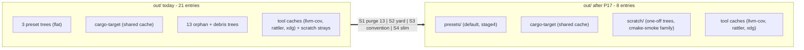
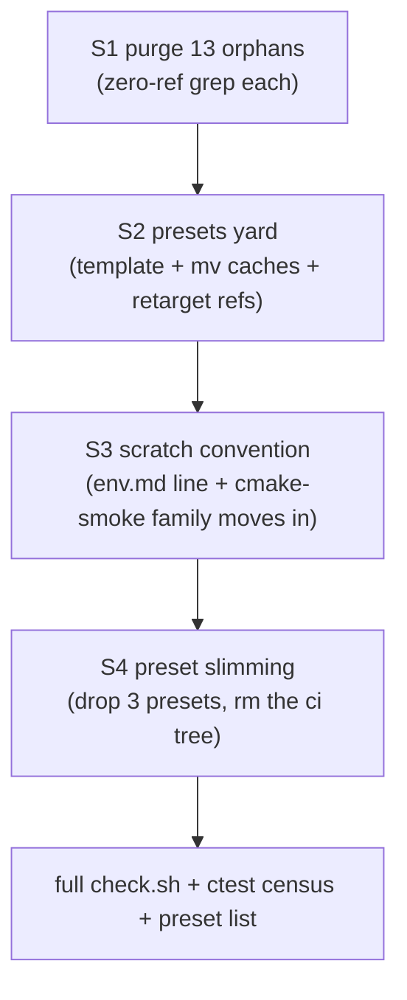

# out/ layout plan - hearing #44-47 execution (P17)

> STATUS: PLAN OF RECORD, 2026-11-11 (revision 1). Executes the out/ layout
> hearing recorded in `docs/ve-parity-plan.md` section 2.9 (#44-47, ruled
> 2026-11-11 one by one, A/A/B/A; donor pinned 9d22cba). Backlog row P17
> carries the same scope; this plan adds the step order, evidence rows, and
> the before/after picture.

## 0. Hearing anchors (re-read before each step)

| # | Ruling | One-line scope | Step here |
|---|---|---|---|
| 44 | purge 13 | orphan/debris trees deleted, per-entry zero-reference grep first | S1 |
| 45 | presets yard | binaryDir template `out/presets/${presetName}` + reference retarget | S2 |
| 46 | light scratch convention | `out/scratch/` prefix recorded in env.md, NO auto-clean | S3 |
| 47 | drop 3 presets | release/debug/ci-strict leave the table; default + stage4 stay | S4 |

## 1. Scope and OUT

IN: the out/ purge, the preset yard move with its reference retarget, the
scratch convention line, and the preset slimming.

OUT (hearing 2.9 explicitly-not-touched list): the cmake/ four-file structure,
the IDE folder grouping (hearing #42 landed), the PolyOrch shim, and any
auto-clean machinery (the #46 rejected half - a failure scene is a feature).

## 2. Steps (one commit each)

### S1 - purge (hearing #44)

- Per-entry zero-reference grep over scripts/, pixi.toml, docs/, .github/
  (slash-form patterns; the list rides the commit body as evidence).
- Delete 13: m8-demo, m85-demo, build-m3, build-n2, legacy-www-book, cppbuild,
  dlopen-test-target, abi-v2-cross-target, clock-cross-target,
  embed-sup-test-target, memory-probe, rule-ref-probe, mcp-cli-stale-*, tmp.
- Keep 8 (until S2/S4 reshape them): the three preset trees, cargo-target,
  the cmake-smoke family, llvm-cov, rattler-cache, xdg-cache.
- Evidence: post-delete `ls out/` snapshot rides the commit.

### S2 - presets yard (hearing #45)

- CMakePresets.json: every binaryDir becomes the ONE template
  `${sourceDir}/out/presets/${presetName}`.
- `mv out/build out/presets/default`, `mv out/build-stage4 out/presets/stage4`
  (compile caches preserved, no rebuild tax).
- Retarget references: demo-stage4-m1.sh / demo-stage4-m2.sh (`-B`),
  check.sh ctest-stage4 leg (`--test-dir`), doc mentions (env.md and friends).
- Verify live: `pixi run configure`, `demo-stage4-m1`, ctest census unchanged.

### S3 - scratch convention (hearing #46)

- env.md gains one short section: one-off build trees live under
  `out/scratch/<name>`; no forced auto-clean (failure scenes stay for
  debugging); the recurring purge (S1-style, grep-then-delete) is the backstop.
- Move the live scratch family in: the cmake-smoke trees
  (`out/cmake-smoke*` -> `out/scratch/cmake-smoke*`, four paths inside
  scripts/cmake-smoke.sh).
- NOT moved: the numbering mktemp trees (`out/numbering.XXXXXX`) - they are
  the good citizen (mktemp + trap-clean) and self-destruct already.

### S4 - preset slimming (hearing #47)

- Drop release/debug/ci-strict from all three preset sections (15 entries
  shrink to 6); delete the ci tree (moved into the yard in S2, removed here).
- Verify: `cmake --list-presets` shows exactly default + stage4; the
  zero-reference grep from the hearing re-run once after the drop.

## 3. Verification ledger

| Plant / action | Expect |
|---|---|
| S1 grep each of the 13 names | zero references apiece |
| S1 post-delete ls | 8 entries in out/ |
| S2 configure in the new yard | green; File API reply jsons still resolve |
| S2 demo-stage4-m1 | PASS via the retargeted -B |
| S2 ctest census | 9/9 unchanged |
| S3 env.md section | gate-docs + book checks green |
| S4 cmake --list-presets | 2 configure presets |
| final full check.sh | all green, --list 40 |

## 4. Diagrams

Before/after:

Step order:

## 5. Risks

- A moved tree invalidates any IDE panel pinned to the old path - reopen or
  re-point it; a cold reconfigure costs 1-2 minutes at most.
- S2 reference net: the -B and --test-dir forms are slash-shaped, so the
  B6 join-form lesson does not apply here; a mechanical grep over the old
  paths after the move is the backstop anyway.
- The numbering mktemp trees will still appear at out/ top level briefly
  during gate runs (self-cleaning, accepted as known environment).

## 6. Gate plan

One commit per step; demo-stage4-m1 and the ctest census verify S2 live; the
final full `bash scripts/check.sh` (with --list 40) closes the batch.

## 7. Deviations and debts

- none at plan time.

## 8. Change log

- 2026-11-11 execution complete: all four steps landed same day, one commit
  each, full check.sh all green (--list 40). Beyond-plan finds folded in:
  rule-ref-probe and mcp-cli-stale turned out to be LIVE scratch mechanisms
  (moved into the yard instead of purged); rs demo artifacts proved live and
  moved under out/scratch/ (the "orphans" regenerated because they are
  stage1/stage2 outputs); two move regressions caught by the full gate and
  fixed - twins raced the stage4 reconfigures (RUN_SERIAL added) and the
  neg-floor probe's ../.. hop broke on the deeper scratch dir (heredoc
  rebuilt on PWD). Gate count unchanged at 40.
- 2026-11-11 revision 1: drawn from hearing #44-47 (ve-parity-plan section
  2.9); four steps S1-S4, ledger, before/after diagrams.
