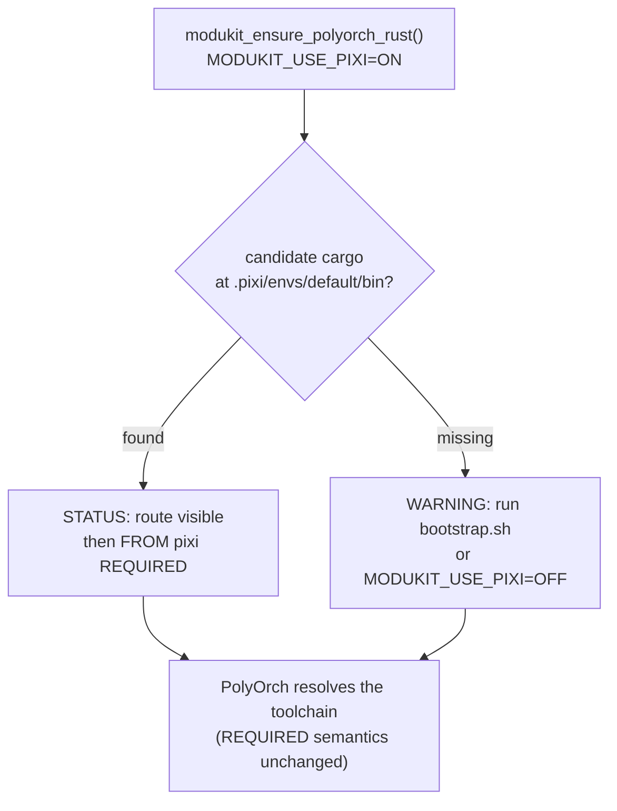

# pixi dual-track plan - escape-hatch visibility, failure guidance, lessons

> STATUS: PLAN OF RECORD, 2026-11-11 (revision 1). Three small improvements
> drawn from the MediaServo dual-track comparison (@ 9d22cba): document the
> system-toolchain escape hatch, add failure guidance in the MediaServo
> bootstrap_hint spirit, and record the dual-track lesson in the reference
> profile. Documentation and message layer only - zero behavior change to
> what runs, zero gate impact. The two "learn MediaServo's automation" ideas
> are recorded as REJECTED with reasons (see section 1).

## 0. Discussion anchors (this plan's source)

Not a numbered hearing - a maintainer-prompted design discussion concluded:

1. ModuKit keeps the EXPLICIT switch (`MODUKIT_USE_PIXI`, default ON) over
   MediaServo's implicit probe chain: the user should always know which cargo
   ran, and an implicit fallback could silently land on a system cmake that
   pixi.toml deliberately does not trust ("system cmake 3.16 is deliberately
   NOT trusted").
2. Configure-time auto-install is forbidden by the family contract anyway
   (PolyOrchPixiHelpers.cmake:12 - "It cannot install pixi as a side effect of
   configure"; polyorch_pixi_tool_install() must be invoked explicitly), and
   MediaServo keeps installation inside bootstrap.sh for the same reason.
3. What IS worth borrowing: MediaServo's bootstrap_hint - when the toolchain
   probe fails, TELL the user where the candidate lives and what to run.
   ModuKit's version-floor FATAL already does this for the version case; the
   missing case is the broken-env case (step T2 below).

## 1. Scope and OUT

IN: one env.md section (escape hatch), one pre-flight hint in
ModuKitPolyOrch.cmake, one dual-track lesson in docs/reference/mediaservo.md.

OUT: configure-time auto-install (family contract, see anchors), implicit
probe chain replacing the explicit switch (rejected - transparency wins),
PolyOrch upstream changes (C2: edits happen on its dev-modukit branch), any
new gate or gate-count change (documentation + message layer only).

## 2. Steps (one commit)

### T1 - escape hatch documented (env.md)

- A short section next to the out/ layout table: `MODUKIT_USE_PIXI=OFF`
  switches the rust face to the system toolchain
  (`polyorch_rust_setup(FROM system)`); what you gain (works without a pixi
  env), what you lose (the pinned cmake/ninja/protobuf versions - pixi.toml
  notes system cmake is deliberately untrusted; the MSRV/cov/serena
  environments remain pixi-only regardless).
- Evidence: env.md renders; the section is findable by the words "system
  toolchain".

### T2 - failure guidance (ModuKitPolyOrch.cmake)

- In `modukit_ensure_polyorch_rust()`, before the `FROM pixi REQUIRED` call:
  probe the candidate path `.pixi/envs/default/bin/cargo`; found -> one
  STATUS line (route visible); missing -> one WARNING with the actionable
  fix (run `bash bootstrap.sh` to provision, or `MODUKIT_USE_PIXI=OFF` for
  the system toolchain) - then let the REQUIRED call fail with PolyOrch's own
  message. MediaServo's bootstrap_hint spirit, no behavior change: the
  REQUIRED semantics are untouched.
- Red proof: temporarily point the candidate check at a nonexistent path ->
  the WARNING fires (observed once, then restored). Full-gate green confirms
  the normal path is zero-noise.

### T3 - dual-track lesson (docs/reference/mediaservo.md)

- One lesson appended: MediaServo runs the IMPLICIT probe chain (bare
  `polyorch_rust_setup()`, pixi-first with system fallback) plus a HARD gate
  (pixi missing = ERROR, no degradation); ModuKit runs the EXPLICIT switch
  plus a SOFT gate (demo legs SKIP). Both satisfy "use pixi when available,
  fall back otherwise"; the difference is transparency vs convenience, and
  ModuKit's gates are actually MORE forgiving than the donor's. Keep the
  explicit switch; borrow the failure guidance (T2).

## 3. Verification ledger

| Plant / action | Expect |
|---|---|
| T1 env.md section | gate-docs green; section greppable by "system toolchain" |
| T2 candidate path present | STATUS route line on configure |
| T2 candidate path planted-missing (temporary) | WARNING with the two fixes fires |
| T2 restored | configure green, zero new noise |
| T3 lesson | gate-docs green |
| final full check.sh | all green, --list 40 (unchanged) |

## 4. Diagram

Failure-guidance flow (T2):

## 5. Risks

- T2's WARNING branch cannot be force-tested without breaking the real pixi
  env, so the red proof uses a temporary path swap, not a real env break
  (accepted; the logic is a one-line existence check).
- The hint hardcodes the default-env candidate path; a user running a
  different pixi env sees a stale hint - accepted, the default env IS the
  documented dev entry and the message says "candidate".

## 6. Gate plan

One commit for the whole batch (documentation + one CMake message); the full
`bash scripts/check.sh` closes it (gate count unchanged at 40).

## 7. Deviations and debts

- none at plan time.

## 8. Change log

- 2026-11-11 revision 1: drawn from the MediaServo dual-track discussion;
  three steps T1-T3; two automation ideas recorded as rejected (section 0).
