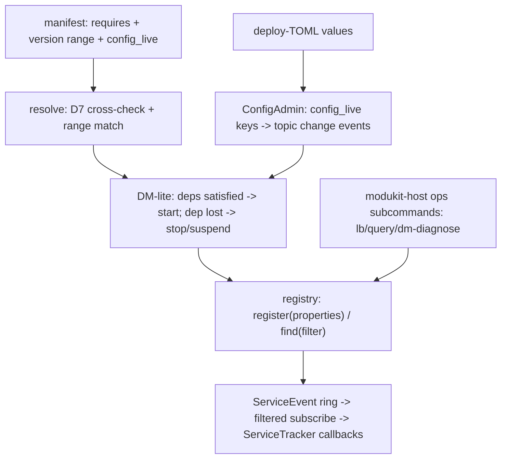

# Plugin-management parity plan - service query, declarative components, ops face

> STATUS: PLAN OF RECORD, 2026-11-23 (revision 2). Drawn from a three-framework
> capability audit (`.refinfo/CppMicroServices` v3.8.x, `.refinfo/celix` 3.0.0-dev,
> `.refinfo/CTK` PluginFramework - all local-clone-verified, file:line in the
> audit trail). Maintainer direction: focus plugin management + polyglot plugins,
> Stage 5 (remote WebRTC) explicitly out. Adjudication points A1-A6 walked one by
> one and ALL RESOLVED A (2026-11-23); execution-ready, S1-S4 below.

## 0. Discussion anchors (the gap audit's conclusions)

ModuKit already LEADS the three donors on: polyglot C-ABI exit (24 verbs +
wire-native plugin door), multi-process isolation (exe placement + proc-wire +
ORPHAN-PROOF), deterministic clock v3, parent-to-child push + bounded outbox,
resource integrity (D30 sha256), and the Failed lifecycle state (none of the
three has it). The real gaps concentrate in the OSGi "service query + component
declaration" layer:

- P1 (no ruling conflict): LDAP/property filter, ServiceTracker pattern,
  service-event completeness + filtered subscription, requires version ranges.
- P2 (spec or donor precedent exists): DM-lite declarative components,
  ConfigAdmin / `config_live` landing, ops command face, lazy activation.
- Trigger/hearing items: in-place update (whitepaper §4.1 debt), ServiceFactory
  (conflicts with D4 single-instance), RSA remote services (celix blueprint).

Existing anchors that SHRINK the work: `registry.rs` already has
`subscribe() -> Receiver<ServiceEvent>` and `acquire/lookup/snapshot`;
`DepPolicy` (wait/failfast/fallback) is implemented; `config_live` hot-lane spec
is recorded in modules/05 §6 (trigger-gated, this plan is the maintainer trigger).

## 1. Scope and OUT

IN: P1 four items (S1-S2), P2 four items (S3-S4), trigger-item rulings A4-A6.
OUT: Stage 5 / RSA implementation (blueprint recorded only), bundle signing /
permission admin (all three donors lack it), multi-version active coexistence
(D4), Metatype XML OCD (CTK-only, TOML world defers), wires/capability resolver
(CppMS Resolver is an empty shell; D34 capability freeze + host discovery is our
adjudicated path).

Frozen-surface discipline (D87/D83): new embed verbs are tail-additions by
RECORD (D83 record tier); any modify/remove/semantic-change to a frozen surface
routes through a hearing. EventStream/ObsEvent variant additions are checked
against the frozen list at implementation time.

## 2. Adjudication points (all RESOLVED A, 2026-11-23)

| # | Question | Recommendation |
|---|---|---|
| A1 | P1 scope/order: all four in S1-S2? | **RESOLVED A** (2026-11-23): all four; S1 filter, S2 tracker+events+ranges |
| A2 | LDAP route: hand-rolled RFC1960 subset vs vendored crate | **RESOLVED A** (2026-11-23): hand-rolled RFC1960 subset, zero new deps (offline box cannot audit a crate; subset is small and C0-provable) |
| A3 | P2 inclusion/order: DM-lite + ConfigAdmin + ops face + lazy? | **RESOLVED A** (2026-11-23): S3 DM-lite+ConfigAdmin, S4 ops face; lazy OPTIONAL/trigger-gated (no consumer yet; supervisor startup semantics untouched) |
| A4 | In-place update: implement now vs keep trigger-gated | **RESOLVED A** (2026-11-23): keep trigger-gated; whitepaper §4.1 debt recorded in §8, celix event-thread-isolated lifecycle handler is the reference when a real update demand fires |
| A5 | ServiceFactory / per-consumer instances vs D4 | **RESOLVED A** (2026-11-23): maintain D4. Per-consumer state = identity-keyed maps in the shared instance; refcount = existing registry `holds` (acquire/release); cleanup = stop/uninstall + ServiceEvent + DM-lite. Only true prototype (physically distinct object per get) is a D4-hearing trigger |
| A6 | RSA remote services | **RESOLVED A** (2026-11-23): record celix RSA as the cross-machine blueprint reference; do NOT implement (cross-machine rides S5, excluded; same-host already covered by proc-wire/iceoryx2 - no duplicate) |

## 3. Steps

### S1 - property filter + filtered query (P1-a) — LANDED 2026-11-23 (9d96f5c + df5f2df)

- New `crates/modukit-core/src/filter.rs`: RFC1960 subset parser + matcher
  (`=`, `&`, `|`, `!`, comparisons, `*` wildcard, present-test). Pure, no deps.
- Registry: `find(filter)` alongside existing `lookup/acquire`; service
  properties become a typed map on registration (today: type_id only).
- C ABI: ONE tail-add embed verb `modukit_embed_find_services(filter_str)` ->
  id list (D83 record tier; v1 prefix byte-identical). Three-language skins
  re-emit (regen-fdset/golden gates).
- C0: planted malformed filter reddens; match/non-match fixtures; liar fixture
  for a filter that claims a property the service never declared.

### S2 - tracker + service events + version ranges (P1-b/c/d)

- ServiceTracker: core Rust helper (track filter + add/set/remove callbacks)
  riding the existing `subscribe`; per-language THIN sugar above the generated
  floor (D63 allows semantics-free sugar, fixture-tested).
- ServiceEvent: audit current variants vs REGISTERED/MODIFIED/UNREGISTERING;
  fill gaps; filtered subscription (filter arg on subscribe). Ring/obs variant
  additions checked against D87 frozen list first.
- requires version ranges: manifest `version = ">=1.2,<2"` on a requires entry;
  resolve-time check; optional cascade-start of the highest matching provider
  (CTK Require-Plugin precedent). D7 cross-check extended; liar fixture for a
  range that no installed provider satisfies.

### S3 - DM-lite + ConfigAdmin landing (P2-a/b)

- DM-lite (plugin-level granularity recommended; celix DM is the reference,
  lighter than CppMS SCR): a plugin's `requires` drives its lifecycle -
  required deps satisfied -> eligible to start; a required dep lost ->
  stop/suspend per `on_down`; cardinality + add/set/remove callbacks. No
  intra-plugin multi-component SCR in year 1.
- ConfigAdmin: implement the recorded `config_live` spec (modules/05 §6) -
  declared keys receive change events as ordinary topics; undeclared keys never
  hot-apply (liar fixture family). ADD file persistence (CTK precedent; CppMS
  itself does not persist - we surpass it). Deploy-TOML stays the value source.
- C0: a `config_live` plugin fixture + a liar that hot-applies an undeclared key.

### S4 - ops command face (+ lazy if A3 includes it) (P2-c/d)

- Ops face: extend the debug-reader into "commands as services" (celix shape:
  lb / start / stop / query(filter) / dm-diagnose), exposed as `modukit-host`
  subcommands (no new bin). Read-only by default; mutating commands gated.
- Lazy activation (OPTIONAL per A3): finalize-on-first-acquire (CTK default-lazy
  precedent; CppMS declared but never implemented it). Supervisor stays eager
  for required-at-boot plugins.

## 4. Verification ledger

| Plant / action | Expect |
|---|---|
| S1 malformed filter string | parse error, deterministic, no panic |
| S1 filter matches / does not match | correct id set; liar fixture reddens |
| S1 new embed verb | regen-fdset/golden byte-identical; v1 prefix unchanged; three skins re-emit |
| S2 tracker add/set/remove | callbacks fire on register/modify/unregister |
| S2 unsatisfied version range | deterministic resolve failure before plugin code runs |
| S3 required dep lost | plugin stop/suspend per on_down; dm-diagnose shows why |
| S3 config_live declared key | change event on topic; undeclared key liar reddens |
| S3 persistence | config survives restart (file store) |
| S4 ops query | filter query over the live registry; mutating command gated |
| each step | full `bash scripts/check.sh` green; demo/ctest evidence per step |

## 5. Diagram

## 6. Risks

- Frozen-surface boundary: every new verb/variant is checked against D87 before
  landing; tail-add by record, break by hearing (D83). No silent semantic change.
- Offline crate audit: a vendored LDAP crate cannot be fully audited on this
  box (no egress) - A2 recommends the hand-rolled subset for that reason.
- Ring variant growth: ObsEvent additions must not break the debug-reader or
  the frozen dictionary; checked at S2.
- DM-lite granularity: plugin-level keeps year-1 simple; intra-plugin SCR is a
  future hearing if a real consumer needs multiple components per plugin.

## 7. Gate plan

No new check.sh legs preferred: filter/tracker/DM/ConfigAdmin proofs ride unit +
integration tests in `cargo test --workspace` (existing leg) and one demo fixture
per step under the existing demo/ctest census. New embed verb rides
regen-fdset/golden + embed-parity + capability-ledger (existing legs). Full
`bash scripts/check.sh` closes each step; leg count unchanged unless a step
proves a genuinely new surface (then recorded, not silent).

## 8. Deviations and debts

- Whitepaper §4.1 in-place update remains a recorded debt (A4 keeps it
  trigger-gated); celix lifecycle-handler isolation is the reference.
- D4 single-instance stands (A5); ServiceFactory would need a hearing.
- RSA blueprint recorded (A6), implementation deferred with Stage 5.

## 9. Change log

- 2026-11-23 revision 3: S1 LANDED (9d96f5c filter.rs + registry.find;
  df5f2df modukit_embed_find_services D83 tail-add + three skins + count pins
  24->25 / rung-0 16->17). Full ci all green. S2-S4 remain.
- 2026-11-23 revision 2: A1-A6 walked one by one, all RESOLVED A. P1 four items
  confirmed (S1 hand-rolled RFC1960 filter subset, zero new deps; S2
  tracker+events+ranges); P2 = S3 DM-lite+ConfigAdmin, S4 ops face, lazy
  trigger-gated; update/D4-factory/RSA kept trigger-gated or ruled-divergent with
  references recorded. Execution-ready.
- 2026-11-23 revision 1: drawn from the three-framework gap audit; P1/P2 steps
  S1-S4; adjudication points A1-A6 ARMED for the one-by-one walk.
