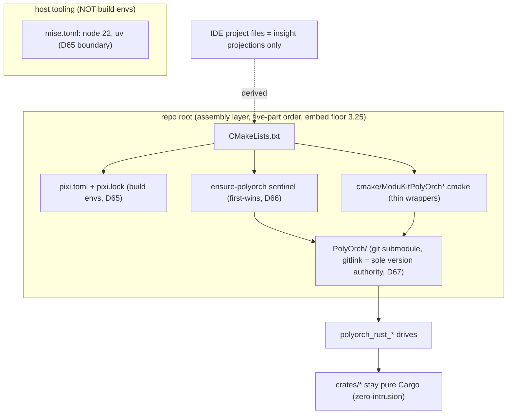
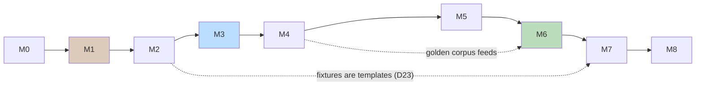
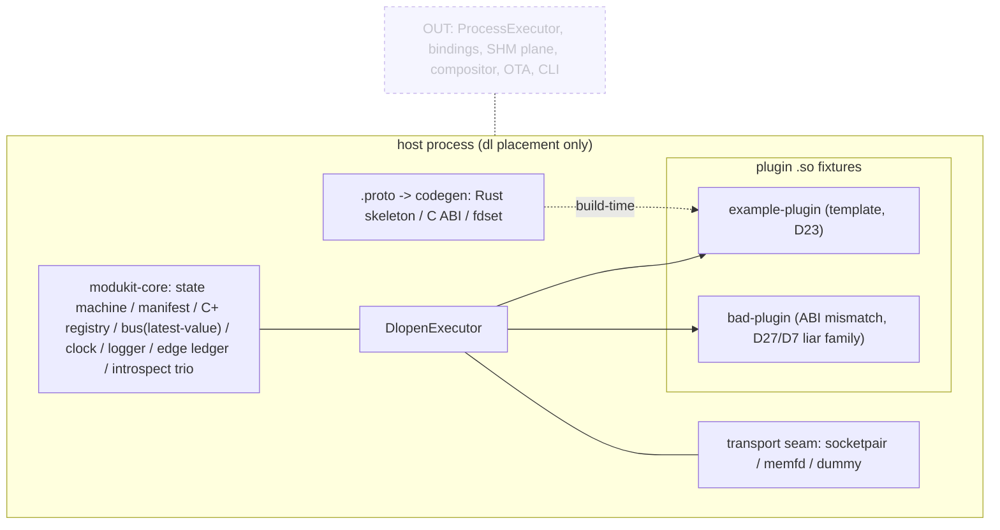

# Stage-1 Resumption Plan - Outline & Maps

> Status: DRAFT for maintainer review. Plan is NOT execution - Stage-1 resumption
> proceeds only on the maintainer's explicit instruction (status.md convention).
> Scope anchor: `docs/architecture.md` §10 (In/Out lists are quoted, not reinvented).
> Decision anchors: D64-D67 (build orchestration), D68-D73 (media-base doctrine,
> relevant as posture only), kernel-v0 surgery points (architecture.md §8 note).
> Every milestone carries a C0-style runnable check with an expected first-red.

## 0. Goal and boundary

Deliver the Stage-1 in-process kernel exactly as §10 scopes it: state machine +
manifest v0 + C+ registry + `dl` executor + contract codegen v0 + minimal bus +
transport seam (local backends only) + observability floors + bundle install
protocol, proven by the example/bad plugin fixtures and the three acceptance
tests. The build-orchestration trio (PolyOrch submodule, pixi env, root CMake
assembly) lands FIRST so every later milestone is driven through the adopted
orchestration instead of retrofitting it (D64-D66).

Explicitly out (per §10, no drift allowed): ProcessExecutor/shadow-runner, all
language bindings, LDAP/tracker/factory/leases, compositor, SHM data plane,
external C-ABI export freeze, OTA, CLI, recorder/replay implementation.

## 1. Map A - build topology at landing (D64-D67 shape)

## 2. Milestone outline

| M | Name | Ships | Depends (D) | C0 check (first-red expected) |
|---|---|---|---|---|
| M0 | Housekeeping calls | push decision OPEN; restart backlog R closure OPEN; submodule SHA CHOSEN + APPLIED 2026-10-15: 3cbc155 (gitlink pin landed at M1; no fetch needed - object already local) | - | `git submodule status` shows the pin (verified green 2026-10-15) |
| M1 | Build trio landing | LANDED 2026-10-15 (explicit maintainer go): `.gitmodules` (path+url, no branch=), `pixi.toml` {tools,rust} + committed `pixi.lock`, bootstrap.sh/.bat pixi guarantee (step 4), root `CMakeLists.txt` five-part skeleton `LANGUAGES CXX` (PolyOrch PlatformSupport demands a CXX identity before embed - genuine first-red observed and answered, not the anticipated one), `cmake/ModuKitPolyOrch.cmake` sentinel wrapper; version-source wiring stays for M2 | D64-D67 | observed red (no files) -> red (CXX contract) -> green (`pixi run configure`: self-embedded at gitlink pin); `bash -n bootstrap.sh` green; extended-scope C1 red/green proved 2026-10-15 |
| M2 | Cargo workspace scaffold | LANDED 2026-10-15 on branch `stage1/m2-cargo-scaffold`: root `Cargo.toml` (resolver 3, edition 2024, workspace.package version 0.1.0), `crates/modukit-core` + `example-plugin` + `bad-plugin` stubs (fixture crate-shapes per D23/§10; symbols land M3), `Cargo.lock` committed, `.gitignore` +target/, version single-source wiring joined (the M1->M2 review patch) | §8 deliverable shape, D23, D67, constraints.md, C2 | observed red (wiring first, no Cargo.toml -> FATAL 'single-source contract broken') -> green (cargo check + configure complete); rustc 1.99 via pixi env |
| M3 | Kernel vertical slice | LANDED 2026-10-15 on master (corrected C2): 6 modules (error/identity/lifecycle/manifest/registry/executor+abi/kernel), ABI-v1 fixtures, 27 tests (lifecycle 7 / manifest 6 / registry 10 / dlopen 4 incl. in-test-built cdylib walk + AbiMismatch{999} rejection parking FAILED, no crash); executor seam + Failed edge + message-shaped service API delivered | D3/D4/D7/D13 | TDD first-red observed (unresolved-module imports before implementation); clippy -D warnings + check.sh green | AMBIGUITY adjudications (M3 close-out): ABI field set & ServiceCall buffers = M4 codegen freezes (D13 single door); size guard rejects undersized, accepts larger tail (Visia self-describe precedent); missing D51 codes ride CONTRACT_VIOLATION pending vocabulary pass; ranking rides properties key until M4; requires policy default failfast (D3 determinism); registry event channel bounded-64 drop-on-full (M6 ring replaces); id grammar validation = M7 cross-check; reverse-DNS policing deferred as documented |
| M4 | Contract codegen v0 | LANDED 2026-10-15: contracts/ ledger (modukit.proto option ext + org.modukit.runtime.proto = D51 fourteen codes + D27 shared body, demo contract with two methods + sentinel enum; all hand-numbered D12 1)), protoc-36.2 fdsets checked in, `crates/modukit-codegen` (zero-dep hand-written wire decoder dogfooding D12 2) skip-unknown; skeleton emit: SERVICE_ID const + dispatch enum + author trait + generated Error mirror; C-ABI vtable shade + stdint header = shape per §1), golden corpus + 4 golden-compiles tests, regen-diff gate = check.sh #6 (skip-when-absent kept), D51 rewiring via parity test (kernel error.rs untouched, subset pinned); bin seam `protoc-gen-modukit @fdset --output_dir` (real protoc-plugin stdin seam deferred) | D12/D13/D27/D9 | first-red golden-before-impl E0432 observed; fdset tamper -> regen-diff RED -> restore green; golden drift -> RED; C1 planted probe -> RED -> contracts/ added to canonical scope (conventions + check.sh) with proof |
| M5 | Bus + seam | LANDED 2026-10-15: in-process topic bus in core (kernel-owned QoS {LatestValue default, KeepAll, Lossy(n), Bounded}; per-subscription drop-oldest ring Receiver std-only with visible drop counts; late-join current value; 3 commandments as tests; KeepAll/Bounded refuse at subscribe - typed Deferral, never silently latest) + new std-only `crates/modukit-transport` (Transport trait owned-value verbs; Dummy + SocketpairLane loopbacks under ONE contract harness; MemfdBlob via documented-unsafe memfd_create shim; self-sufficient SlotHandle{slot,epoch,layout} + PoolStub epoch-reuse -> EPOCH_EXPIRED + two-stage meta-then-data View with Drop/C release pairing; vendor-lock test proves zero crates.io additions) | D9/D10/D11/D14/D15/D69 | first-reds x3 quoted (unresolved bus/seam/descriptor imports); orchestrator re-ran independently: 60 tests, clippy all-targets clean, check.sh green; AMBIGUITIES adjudicated: spec drop-oldest ring beats briefing mpsc paraphrase (scope wins); QoS = last-publish declaration, default LatestValue; superseded-unread counts as drop (observation not enforcement); BusError standalone (no dead KernelError surface); transport crate stays core-independent, D51 names reused as strings not deps - shared-vocabulary origin deferred to the freeze hearing; MemfdBlob = single-blob lane, FIFO harness covers Dummy+Socketpair |
| M6 | Observability floors | LANDED 2026-10-16: clock (D20 {Real|Sim|Step}, timers POST as jobs only, never closures), events (D17 Observatory ring cap-8192 drop-oldest resumable tail+gap), logger (D19 LogEvent same ring, per-component visible counts), edge_ledger (D18 ring-projection at emit doorway, call-edge table deferred to stub doorway), counters (D21 relaxed atomics at existing choke points only: kernel mv door, acquire/release, publish fan-out), introspect trio (D17 read-only org.modukit.* services + LoadStamp ABI records), testhost (D24 step-clock production kernel, fold checkers, zero sleeps) | D17-D21/D24/D6 | 6 first-reds quoted; acceptance: churn-fold GREEN, step-replay dl-GREEN (exe leg = Stage-2 dual-placement), bad-plugin ledger-equality RED-fixture (FAILED + zero ModuleLoaded + loaded:false stamp); 88 tests total; AMBIGUITIES adjudicated: ledger=projection not call-table (caller attribution needs stubs), LedgerDump=module ledger (fdset equality rides M7/M8), rate-limit deferred to visible-counts per 06 s6, tail-poll EventStream (invariant 5 untouched), load_base=descriptor hint (real base at PAL day) |
| M7 | Bundle install protocol | LANDED 2026-10-16: hand-written FIPS 180-4 SHA-256 (std-only, streaming, NIST vectors incl. 1M-'a'; vectors caught a real K[26] constant typo), D28 protocol bundle.rs (staging -> verify all listed hashes BEFORE install root touched -> inode-dedupe >1MiB objects read-only 444 -> atomic rename), D7 cross-check at install (untouched DlopenExecutor handshake + strict self-report: id/version must match manifest, missing = fail), reverse-DNS grammar validator shared in identity.rs (>=2 lowercase labels; publish hot path untouched), load-time re-verification API, fdset-equality seam (set_contract_ledger + contract_ledger() accessor - dump() shape stayed frozen), bad-plugin RED proof wired | D28/D31/D7/D9/D34/D51 | tampered install RED + clean GREEN; inode/nlink dedupe proven via MetadataExt; 6 first-reds incl. vectors-caught bug; AMBIGUITIES adjudicated: hash list lives INSIDE modukit.toml (no second truth, D31 precedent), integrity codes ride CONTRACT_VIOLATION pending a real D51 hearing (no INTEGRITY_FAILED in the frozen 14), provides/requires-summary cross-check deferred (descriptor has no such fields - ABI shapes frozen), verify_for_load auto-hook awaits kernel-held install state, zip form = D28 CLI trigger |
| M8 | Stage-1 acceptance | LANDED 2026-10-16: `examples/stage1_demo.rs` (public APIs only) + `scripts/demo-stage1.sh` gate - real chain: cdylib build -> bundle w/ [[files]] checklist -> install protocol -> INSTALLED->...->ACTIVE walk observed on ring -> NativeService echo (message bytes only, D69 honored) -> bus late-join -> non-zero counters at every touched door -> uninstall + data-root -> negatives (tampered RED pre-root; ABI-mismatch RED + kernel FAILED with D27 record, zero segfaults); coverage via dedicated pixi `cov` env (own solve-group, default env untouched): 82.3/80.3/72.7, TOTAL 78.6% >= 60% soft MET, no metric-chasing tests; §10 mapped 1:1 (GAP-1 contract-suite structure judged satisfied-as-written, named dual-placement suite + exe leg = Stage-2 with ProcessExecutor); demo gate proven falsifiable (fake-cargo probe -> RED) | all above | STAGE1-DEMO PASS + check.sh green + 108 tests + coverage table; ambiguities: FAILED-for-tampered ruled N/A-by-protocol (bundle door refuses pre-kernel), BundleError hint() deferred to D51-style hearing, fixture-crate 0% = measurement boundary not a gap, scratch kept at out/m8-demo |
| M8.6 | Demo shelf (ruling B, 2026-10-16) | LANDED: stage1_demo moved from modukit-core into workspace member examples/ (package modukit-examples, rs band; lane FOLDER examples/rs; public-API discipline by construction; C1 scope gained examples/) | ruling B (mainstream: VisiaEngine/dora/tokio) | first-red old path; 7 edges + ctest 6/6 green |
| M8.5 | Lane wiring (D66 fulfillment) | LANDED 2026-10-16 (W0-W4, commits 92306d2..db7267d): shelf split to test-plugins/ (first-red: cross-shelf relative path broke, fixed), pixi translation live (configure prints route + cargo path), FIVE crate lanes + codegen bin handle + stage1_demo EXAMPLE lane ride the graph via shared BASE_DIR out/cargo-target with ALL aggregate modukit-rust-build (mediators non-ALL per T-H10; aggregate FOLDER-less), 5 ctest bridges mirroring helper argv + example_stage1_demo entry - codemodel proves the 5 FOLDER shelves exactly, clean-cycle (all -clean -> rebuild 7 edges -> ctest 6/6) green. Drifts recorded: codegen = 2 handles; file-API query lands next-configure (documented); run button inherits shell cargo (mise-shim red = documented human surface, ctest entry immune via CARGO injection). | D66 (fulfillment, no new ruling) | first-reds: 0 project targets + Total Tests 0 (observed fresh); acceptance: 7 cargo edges, ctest 6/6, FOLDER probe exact, check.sh + demo-stage1 regression green |

## 3. Map B - execution sequence (parallelism visible)

M5/M6 are near-independent once M4 locks contract shapes; if solo+AI
builder mode parallelizes, run M5 seams while M6 floors fill in.

## 4. Map C - Stage-1 runtime picture (what exists, what does NOT)

## 5. Decision-dependency index

Build: D64 adoption · D65 mise/pixi · D66 root assembly · D67 gitlink pin.
Kernel: D2/D3 (tiers, states) · D4 (registry) · D7 (manifest) · D10 (bus QoS) ·
D11 (seam slots) · D12/D13 (contract door + codegen) · D14/D15 (descriptors, fd) ·
D17-D24 (observability, fixtures, testhost) · D27/D28/D31 (error vocab, bundles) ·
D68-D73 (posture card; frame clause constrains M5 API shapes - no raw
frame-pointer arguments anywhere in contracts).

## 6. Risks and rollback

| # | Risk | Mitigation / rollback |
|---|---|---|
| 1 | PolyOrch pin choice on an untagged upstream (5+ commits/day era) | M0 decision: maintainer names the SHA; gitlink is the only record (D67); bump commits revert cleanly |
| 2 | pixi cold-cache on CI-less solo machine | M1 check uses `pixi lock --check`; offline fallback = `FROM system` escape hatch documented in D65 (exception, logged) |
| 3 | kernel-v0 backup is OUTSIDE repo and transient (status note) | M3 re-derives the three surgery points from architecture.md only; no file dependency on the parked backup |
| 4 | codegen gate drift (golden files vs protoc version) | pin protoc via pixi build env (D65), regen-diff gate RED on any uncommitted regeneration (D12) |
| 5 | scope creep toward bindings/SHM (Stage-2 magnets) | §10 Out list quoted in M8 acceptance; PR-style self-review against the table |
| 6 | fast-model family balance failures for delegated subtasks | keep delegation to premium family; inline sandbox otherwise (PIT-2 precedent) |

## 7. Non-goals (one breath, no negotiation needed)

No CLI, no OTA, no multi-process, no bindings surfaces, no compositor, no export
freeze decision, no MediaServo wiring (D73: parallel until API stabilizes), no
doc changes beyond milestone-sync (status.md/verification rows as gates land).

## 8. Definition of Done (Stage-1)

1. `bash scripts/check.sh` all green with fmt/clippy/test NO LONGER skipping.
2. M8 demo script passes; bad-plugin produces the honest D27 record, not a segfault.
3. §10 In list mapped 1:1 to merged milestones (checklist table in the PR-equivalent commit message).
4. status.md phase line updated; D-records touched: NONE (no new rulings without a hearing - doorbell discipline per D71).
5. Coverage measured against the 60% soft gate (D50); no metric-chasing tests.

## 9. M8.5 lane wiring - plan of record (D66 fulfillment)

Reference pattern = `.refinfo/VisiaEngine` measured 2026-10-16 (six takeaways carried:
sentinel first-wins reuse; T-B1 pixi translation (option -> `polyorch_pixi_setup` +
`polyorch_rust_setup(FROM pixi)`); crates lane with FOLDER = position-mirror ("crates/CRATE";
action targets and tree-level aggregates deliberately FOLDER-less); R10 naming (real target =
name = ctest entry, `-run`/`-test`/`-clean` button suffixes, LABELS route `-L/-LE`); ctest:
`enable_testing()` BEFORE all add_subdirectory (measured silent-drop trap - already satisfied in
our root) + `SKIP_RETURN_CODE 77` (needs >=3.24 - our floor 3.25 covers it); install/export:
NOT copied blindly - the "cargo owns artifacts, CMake never owns them" imported-target contract
(config template + PACKAGE_PREFIX_DIR relocation + byte-identical header layout) is the price of
an export tree and rides the first real consumer, deliberately out of M8.5.)

| W | Work package | Deliverable | First-red (baseline today) | Done when |
|---|---|---|---|---|
| W0 | shelf split (maintainer ruling F, 2026-10-16) | `git mv crates/example-plugin crates/bad-plugin -> test-plugins/`; root members two lines; FOLDER grammar gains `test-plugins/<name>`; `plugins/` reserved-by-grammar for PRODUCTION first-party plugins, NOT created empty (arrives with its first resident; graduation = one `git mv`). Rationale: future bundle automation globs `plugins/*/` - fixtures must never sit on the product shelf (Janus/GStreamer/cargo-test-fixtures precedent); package NAMES unchanged so every `-p example-plugin` reference in tests/build stays valid | today both fixtures sit in `crates/` polluting the engine shelf (observed) | workspace builds 108 green from the new paths; `cargo build -p example-plugin -p bad-plugin` unchanged |
| W1 | pixi translation | `MODUKIT_USE_PIXI` option (default ON) + `modukit_ensure_polyorch_rust()` calling `polyorch_pixi_setup(COPY_SCRIPTS)` + `polyorch_rust_setup(FROM pixi)`, route reported | configure prints no POLYORCH_RUST_CARGO route line (observed: no such call exists) | configure line `rust face: route=pixi, cargo=<env cargo>` appears |
| W2 | crates lane | `cmake/ModuKitPolyOrchCrates.cmake` + root call `modukit_polyorch_crates()`: five `polyorch_rust_build` lanes (modukit-core rlib, modukit-transport rlib, modukit-codegen lib+bin on FOLDER `crates/<name>`; example-plugin/bad-plugin cdylib on FOLDER `test-plugins/<name>` post-W0), shared BASE_DIR `out/cargo-target` (git-ignored), per-lane -test/-clean buttons | `cmake --build out/build --target help` shows 0 project targets (observed 2026-10-16: only phantoms) | every crate builds through the graph; deps edges visible (codegen/core/transport as cargo sees them) |
| W3 | example buttons | stage1_demo exposed as a run button + `ctest` entry `example_stage1_demo` (staged-binary exec pattern), LABELS routing | `ctest -N` reports no tests (observed: none registered) | the demo runs green through ctest; script gate stays as-is (no duplication of argv - single home per R10) |
| W4 | test bridge + hygiene | per-crate ctest entries bridging `cargo test` suites (one command per lane, skip-code 77 where env-limited), FOLDER/naming table asserted via cmake file API probe | `cmake --build` + `ctest --test-dir out/build` currently vacuous (observed) | ctest lists >= 4 lanes + example entry, all pass/skip honestly; `bash scripts/check.sh` + `scripts/demo-stage1.sh` STILL green (cargo path untouched - C2/D65 boundaries intact) |

Boundaries (explicit, no drift): no install/export tree (see contract note above); no wasm/bindings lane
(lanes appear when their artifacts exist); check.sh and demo-stage1.sh unchanged; vendor_lock + coverage
gates unchanged; zero Rust source edits expected - wiring is cmake-side only (any needed cargo flag
surface goes through PolyOrch params, not by touching crates/). Rollback = revert the W commits, graph
returns to today's skeleton (nothing else depends on it).

Acceptance (all re-run by the orchestrator, not reported-trusted): 1) fresh configure prints the
pixi-route line; 2) `cmake --build out/build` builds all five lanes; 3) `ctest --test-dir out/build`
green-or-honest-skip incl. example_stage1_demo; 4) IDE folders verified via cmake file API (FOLDER set
matches the position-mirror table); 5) cargo gates untouched: check.sh all green + demo PASS line +
108 tests baseline intact.