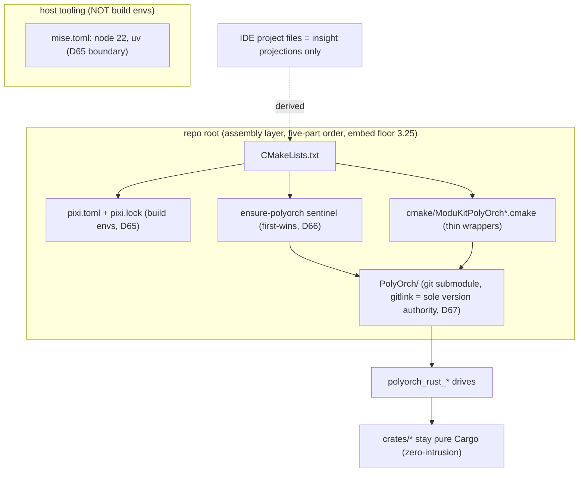
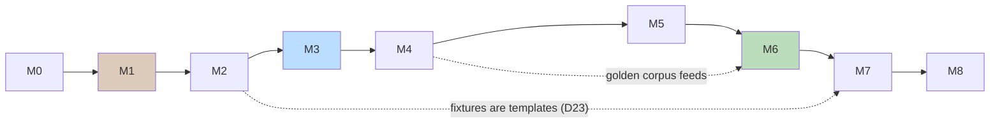
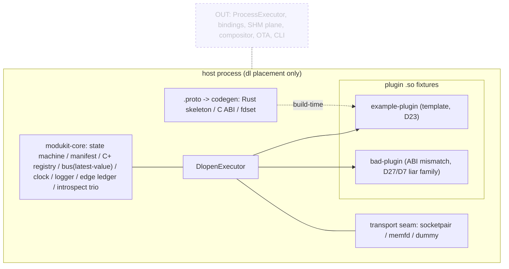

# Stage-1 Resumption Plan - Outline & Maps

> Status: DRAFT for maintainer review. Plan is NOT execution - Stage-1 resumption
> proceeds only on the maintainer's explicit instruction (status.md convention).
> Scope anchor: `docs/architecture.md` §10 (In/Out lists are quoted, not reinvented).
> Decision anchors: D64-D67 (build orchestration), D68-D73 (media-base doctrine,
> relevant as posture only), kernel-v0 surgery points (architecture.md §8 note).
> Every milestone carries a C0-style runnable check with an expected first-red.

## 0. Goal and boundary

Deliver the Stage-1 in-process kernel exactly as §10 scopes it: state machine +
manifest v0 + C+ registry + `dl` executor + contract codegen v0 + minimal bus +
transport seam (local backends only) + observability floors + bundle install
protocol, proven by the example/bad plugin fixtures and the three acceptance
tests. The build-orchestration trio (PolyOrch submodule, pixi env, root CMake
assembly) lands FIRST so every later milestone is driven through the adopted
orchestration instead of retrofitting it (D64-D66).

Explicitly out (per §10, no drift allowed): ProcessExecutor/shadow-runner, all
language bindings, LDAP/tracker/factory/leases, compositor, SHM data plane,
external C-ABI export freeze, OTA, CLI, recorder/replay implementation.

## 1. Map A - build topology at landing (D64-D67 shape)

## 2. Milestone outline

| M | Name | Ships | Depends (D) | C0 check (first-red expected) |
|---|---|---|---|---|
| M0 | Housekeeping calls | push decision (14 local commits) OPEN; restart backlog R closure OPEN; submodule SHA CHOSEN 2026-10-15: 3cbc155 (latest observed, 2026-10-14, same pin VisiaEngine uses; object already resolvable in the root reference checkout - landing needs no extra fetch) | - | `git -C PolyOrch cat-file -e 3cbc1556fa9fc6ccc01ec9268c3c1a769b29c905` resolves (verified green 2026-10-15) |
| M1 | Build trio landing | `.gitmodules` (no branch= field), `pixi.toml` features {tools,rust}, bootstrap.sh/.bat + pixi guarantee, root `CMakeLists.txt` five-part skeleton WITHOUT the version-source line (Cargo.toml does not exist yet; wiring moves to M2 - 2026-10-15 review patch) | D64-D67 | `bash -n bootstrap.sh` green and bootstrap provisions pixi (first-red before the edit); `cmake -S . -B out/build` configures an empty graph (red before files exist); `pixi.toml` lands together with its committed lock - the lock file's existence is that step's own check |
| M2 | Cargo workspace scaffold | root `Cargo.toml` (resolver 3, edition 2024), `crates/modukit-core` + `example-plugin` + `bad-plugin` stubs, `Cargo.lock` committed, `.gitignore` out/ target/, AND the version single-source wiring now joining root CMakeLists to workspace Cargo.toml (moved from M1 - review patch) | §8 deliverable shape, D23, D67, constraints.md | `cargo check -p modukit-core` green; `cmake -S . -B out/build` reads the version from Cargo.toml - first-red before the wiring, green after (the wiring's own red/green pair per C0) |
| M3 | Kernel vertical slice | six-state machine + Failed edge + policy types (D3), manifest v0 TOML (D7), C+ registry (D4 handles/ids/events/snapshot), `DlopenExecutor` (D13 dl side), dlopen integration tests built in-test (kernel-v0 lesson), the three v0 surgery points: executor-trait seam, Failed edge, message-shaped service API | D3/D4/D7/D13 | registry acquire/release unit tests red before implemented; dlopen fixture test green at end |
| M4 | Contract codegen v0 | `.proto` single door + protoc plugin emitting Rust skeleton / C ABI header / fdset (D12/D13), golden-file corpus + regen-diff gate | D12/D13/D27 (`org.modukit.runtime.proto` as first vocabulary) | regen-diff gate RED on a deliberately drifted golden file, GREEN otherwise |
| M5 | Bus + seam | minimal in-process topic bus with `latest-value` QoS (D10), transport seam trait + socketpair/memfd/dummy test doubles (D11), descriptor access protocol shape + two-stage retrieval API (D14) | D10/D11/D14/D15-adjacent | dummy-backend contract tests red->green; no vendor linkage present (grep gate) |
| M6 | Observability floors | introspect trio + `ModuleLoaded` + the three acceptance tests (D17), live edge ledger + `Snapshot.edges()` (D18), logger + `LogEvent` in shared ring (D19), unified clock + timers-as-jobs (D20), gate counters on the same doorways (D21), testhost face (D24) | D17-D21/D24/D44-no-exemption | acceptance trio: one is deliberately RED-fixture (bad plugin), two GREEN |
| M7 | Bundle install protocol | staging -> hash/cross-check -> atomic rename; `bad-plugin` proves ABI-mismatch rejection | D28/D31 | install of tampered bundle goes red (hash mismatch), clean install green |
| M8 | Stage-1 acceptance | end-to-end demo: testhost boots, example plugin walks all six states, service call over local seam, bad plugin lands in Failed with D27 record; full gates: `scripts/check.sh` + fmt/clippy/test now NON-skipping; export-freeze stays trigger-gated (NO freeze decision here) | all above | demo script recorded pass; coverage measured (D50 60% soft gate applies from first crate) |

## 3. Map B - execution sequence (parallelism visible)

M5/M6 are near-independent once M4 locks contract shapes; if solo+AI
builder mode parallelizes, run M5 seams while M6 floors fill in.

## 4. Map C - Stage-1 runtime picture (what exists, what does NOT)

## 5. Decision-dependency index

Build: D64 adoption · D65 mise/pixi · D66 root assembly · D67 gitlink pin.
Kernel: D2/D3 (tiers, states) · D4 (registry) · D7 (manifest) · D10 (bus QoS) ·
D11 (seam slots) · D12/D13 (contract door + codegen) · D14/D15 (descriptors, fd) ·
D17-D24 (observability, fixtures, testhost) · D27/D28/D31 (error vocab, bundles) ·
D68-D73 (posture card; frame clause constrains M5 API shapes - no raw
frame-pointer arguments anywhere in contracts).

## 6. Risks and rollback

| # | Risk | Mitigation / rollback |
|---|---|---|
| 1 | PolyOrch pin choice on an untagged upstream (5+ commits/day era) | M0 decision: maintainer names the SHA; gitlink is the only record (D67); bump commits revert cleanly |
| 2 | pixi cold-cache on CI-less solo machine | M1 check uses `pixi lock --check`; offline fallback = `FROM system` escape hatch documented in D65 (exception, logged) |
| 3 | kernel-v0 backup is OUTSIDE repo and transient (status note) | M3 re-derives the three surgery points from architecture.md only; no file dependency on the parked backup |
| 4 | codegen gate drift (golden files vs protoc version) | pin protoc via pixi build env (D65), regen-diff gate RED on any uncommitted regeneration (D12) |
| 5 | scope creep toward bindings/SHM (Stage-2 magnets) | §10 Out list quoted in M8 acceptance; PR-style self-review against the table |
| 6 | fast-model family balance failures for delegated subtasks | keep delegation to premium family; inline sandbox otherwise (PIT-2 precedent) |

## 7. Non-goals (one breath, no negotiation needed)

No CLI, no OTA, no multi-process, no bindings surfaces, no compositor, no export
freeze decision, no MediaServo wiring (D73: parallel until API stabilizes), no
doc changes beyond milestone-sync (status.md/verification rows as gates land).

## 8. Definition of Done (Stage-1)

1. `bash scripts/check.sh` all green with fmt/clippy/test NO LONGER skipping.
2. M8 demo script passes; bad-plugin produces the honest D27 record, not a segfault.
3. §10 In list mapped 1:1 to merged milestones (checklist table in the PR-equivalent commit message).
4. status.md phase line updated; D-records touched: NONE (no new rulings without a hearing - doorbell discipline per D71).
5. Coverage measured against the 60% soft gate (D50); no metric-chasing tests.
